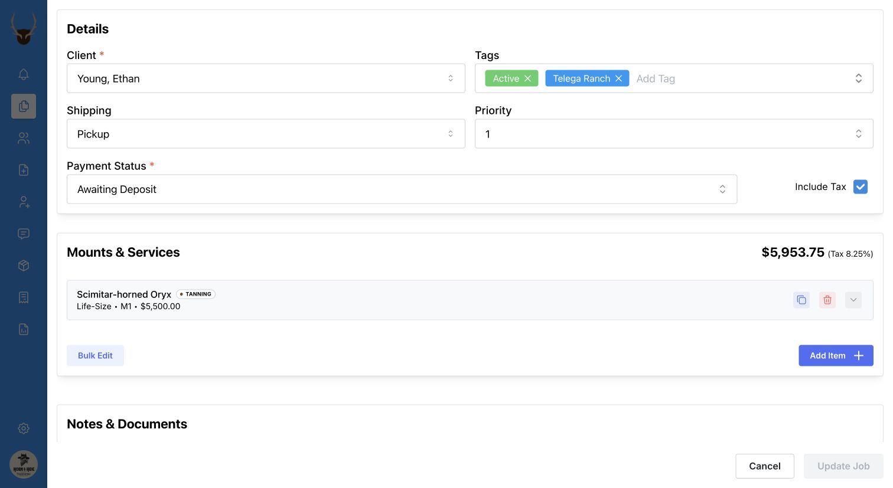
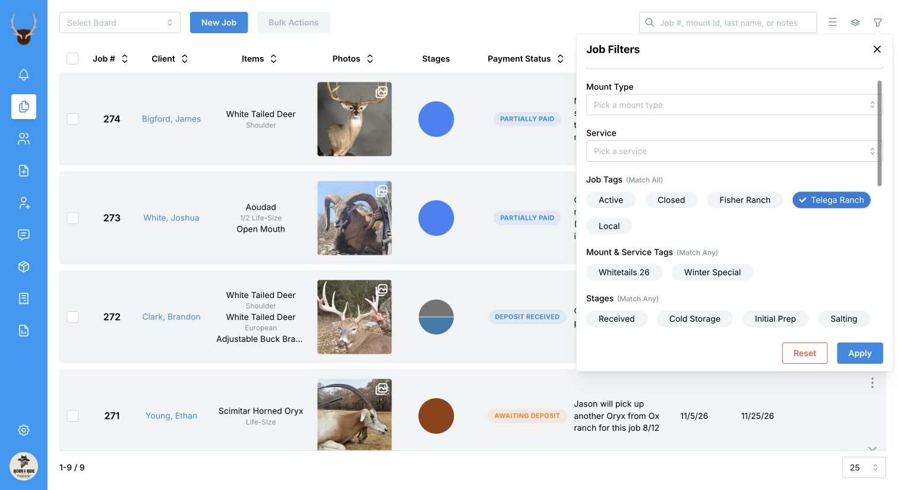

Use job tags to group whole jobs, such as work brought in by a particular outfitter or company. Tag each relevant job with the same name, then filter the jobs board to bring them together.

**Active** and **Closed** have a separate purpose: they control whether a job is open for work. Leave the appropriate status tag in place when adding your own labels. See [Active and closed jobs](/jobs/close-or-reopen-a-job).

## Add a tag to a job

1. Open the job and select **Edit Job**.
2. In **Tags** near the top of the form, select **Add Tag**.
3. Choose an existing tag. To make a new one, type its name, select **+ Create**, then confirm **Create**.
4. Select **Update Job** to save.

When creating a new job, use the same **Tags** field before saving it.

  
  <svg viewBox="0 0 1512 827" aria-hidden="true" style={{ position: "absolute", inset: 0, width: "100%", height: "100%", pointerEvents: "none" }}>
    <path d="M 1180 60 L 1110 106" fill="none" stroke="white" strokeWidth="7" strokeLinecap="round" strokeLinejoin="round" />
    <path d="M 1180 60 L 1110 106" fill="none" stroke="#ef4444" strokeWidth="3.5" strokeLinecap="round" strokeLinejoin="round" />
    <path d="M 1124.7 104.7 L 1110 106 L 1117.0 93.0" fill="none" stroke="white" strokeWidth="7" strokeLinecap="round" strokeLinejoin="round" />
    <path d="M 1124.7 104.7 L 1110 106 L 1117.0 93.0" fill="none" stroke="#ef4444" strokeWidth="3.5" strokeLinecap="round" strokeLinejoin="round" />
  </svg>

To group more work from the same outfitter, select the existing **Telega Ranch** tag on the other jobs. Choose labels you will reuse; keep one-off instructions in the job's **Notes**.

## Find jobs with that tag

1. On the **Jobs** board, select the **filter icon** at the top right.
2. Under **Job Tags**, select your tag, such as **Telega Ranch**.
3. Select **Apply**.

  
  <svg viewBox="0 0 1512 827" aria-hidden="true" style={{ position: "absolute", inset: 0, width: "100%", height: "100%", pointerEvents: "none" }}>
    <path d="M 1438 281 L 1400 320" fill="none" stroke="white" strokeWidth="7" strokeLinecap="round" strokeLinejoin="round" />
    <path d="M 1438 281 L 1400 320" fill="none" stroke="#ef4444" strokeWidth="3.5" strokeLinecap="round" strokeLinejoin="round" />
    <path d="M 1414.1 315.6 L 1400 320 L 1404.1 305.8" fill="none" stroke="white" strokeWidth="7" strokeLinecap="round" strokeLinejoin="round" />
    <path d="M 1414.1 315.6 L 1400 320 L 1404.1 305.8" fill="none" stroke="#ef4444" strokeWidth="3.5" strokeLinecap="round" strokeLinejoin="round" />
  </svg>

**Job Tags** uses **Match All**. Selecting **Active** and **Telega Ranch** finds active jobs carrying that ranch tag. Selecting **Active** and **Closed** together will not find a job, because a job has one status or the other.

For several different outfitters, filter for one at a time. Selecting two outfitter tags together asks for jobs with both tags.

You can combine a job tag with other filters. See [Find and filter jobs](/jobs/find-and-filter-jobs).

## Add the same tag to several jobs

1. On the **Jobs** board, tick the checkbox beside each job you want to tag.
2. Check the selected count, then select **Bulk Actions → Bulk edit**.
3. In **Tags**, choose the tag you want to add, or create it there.
4. Choose **Add Tags**.
5. Select **Update**.

This adds the selected tag to the selected jobs. Check the selection before updating, particularly if you have selected jobs on more than one page.

## Remove a tag from one job

Open the job, select **Edit Job**, then select the **×** on the custom tag in the top **Tags** field. Select **Update Job** to save. This removes the label from that job; it remains available to use on other jobs.

## Use the group

Once you have filtered the board, you can select jobs from the group to [take one payment across several jobs](/payments/split-a-payment-across-jobs).

If the label should apply to particular mounts or services within a job, use [mount and service tags](/mounts-and-services/organize-mounts-with-tags) instead.
