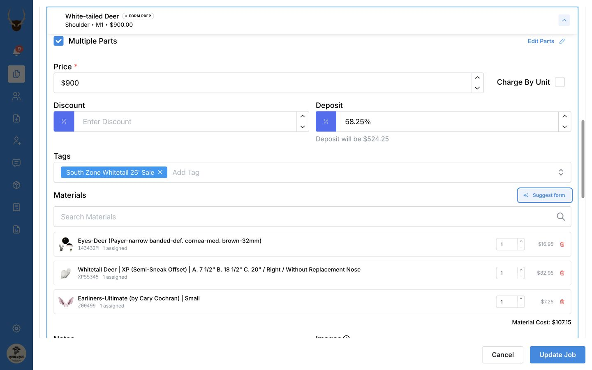
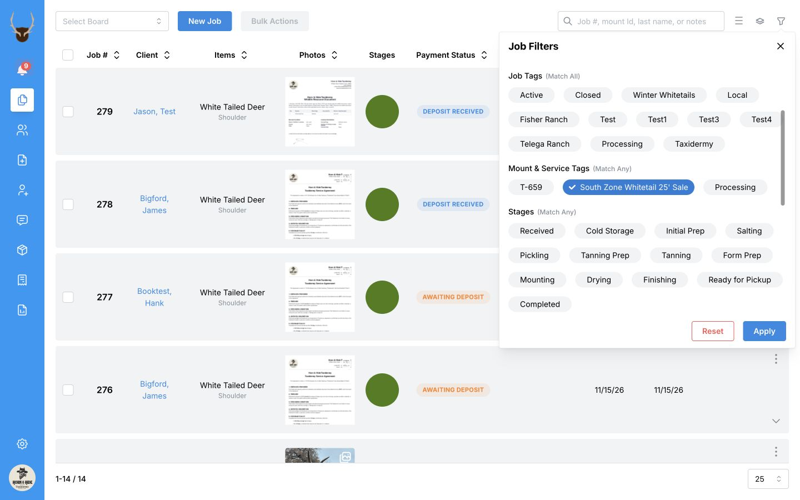

Use mount and service tags to group individual items that have something in common. For example, apply **Whitetails 26** to mounts in a seasonal promotion, or use **Winter Special** for services included in an offer.

The tag belongs to the mount or service you choose. It does not tag the whole job or its other items. For an outfitter or company bringing in whole jobs, use [job tags](/jobs/organize-jobs-with-tags).

## Add a tag to a mount or service

1. Open the job and select **Edit Job**.
2. Under **Mounts & Services**, select the mount or service to open its details.
3. Scroll to that item's **Tags** field and select **Add Tag**.
4. Choose an existing tag. To make a new one, type its name, select **+ Create**, then confirm **Create**.
5. Select **Update Job** to save.

Use the same field when adding a mount or service to a new job. Mounts and services share the same list of labels, so you can reuse a tag on either.

  
  <svg viewBox="0 0 1440 900" aria-hidden="true" style={{ position: "absolute", inset: 0, width: "100%", height: "100%", pointerEvents: "none" }}>
    <path d="M 660 355 L 560 389" fill="none" stroke="white" strokeWidth="7" strokeLinecap="round" strokeLinejoin="round" />
    <path d="M 660 355 L 560 389" fill="none" stroke="#ef4444" strokeWidth="3.5" strokeLinecap="round" strokeLinejoin="round" />
    <path d="M 574.9 392.4 L 560 389 L 569.7 377.2" fill="none" stroke="white" strokeWidth="7" strokeLinecap="round" strokeLinejoin="round" />
    <path d="M 574.9 392.4 L 560 389 L 569.7 377.2" fill="none" stroke="#ef4444" strokeWidth="3.5" strokeLinecap="round" strokeLinejoin="round" />
  </svg>

The screenshot uses a seasonal sale tag. You can choose a name that suits your own promotion, such as **Whitetails 26**, and reuse it on each mount included.

To remove a label, select the **×** on the mount or service's tag, then select **Update Job**.

## Find tagged mounts or services on the jobs board

1. On the **Jobs** board, select the **filter icon** at the top right.
2. Under **Mount & Service Tags**, select the tag you want.
3. Select **Apply**.

  
  <svg viewBox="0 0 1440 900" aria-hidden="true" style={{ position: "absolute", inset: 0, width: "100%", height: "100%", pointerEvents: "none" }}>
    <path d="M 835 295 L 1004 328" fill="none" stroke="white" strokeWidth="7" strokeLinecap="round" strokeLinejoin="round" />
    <path d="M 835 295 L 1004 328" fill="none" stroke="#ef4444" strokeWidth="3.5" strokeLinecap="round" strokeLinejoin="round" />
    <path d="M 992.8 317.7 L 1004 328 L 989.7 333.4" fill="none" stroke="white" strokeWidth="7" strokeLinecap="round" strokeLinejoin="round" />
    <path d="M 992.8 317.7 L 1004 328 L 989.7 333.4" fill="none" stroke="#ef4444" strokeWidth="3.5" strokeLinecap="round" strokeLinejoin="round" />
  </svg>

**Mount & Service Tags** uses **Match Any**. If you select two promotion tags, jobs containing a mount or service with either tag can appear.

The board shows matching jobs, which may contain several animals. Its job count is not a count of tagged mounts.

## Combine tags and filters

A tag is useful for a promotion or another shared group. You do not need to create tags for details already recorded on the mount.

<Tip>
To find whitetail shoulder mounts from a particular period, combine **Species**, **Mount Type**, and **Created** in the board filters. Add your promotion tag if you want to narrow the list to animals included in that offer. See [Find and filter jobs](/jobs/find-and-filter-jobs).
</Tip>

If you want to review individual mounts rather than whole jobs, use the [mounts and services breakdown report](/reports/mounts-services-breakdown). Its **Mount & Service Tags** filter narrows the individual items in the report, alongside its species, mount-type, and date filters.
