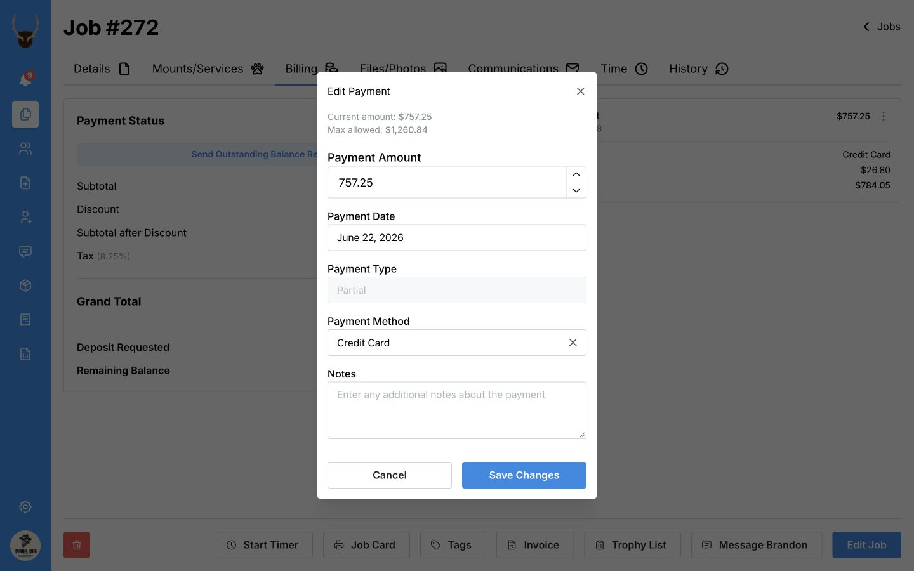

Entered the wrong amount, date, or payment method? You can correct an eligible payment record from the job's **Billing** tab. This is useful for cash, checks, bank transfers, and payments you took outside MountMonitor.

If you charged the card through **MountMonitor Payments**, use [Refund a payment](/payments/refund-a-payment) to return money. Editing or deleting a record does not reverse a card charge.

## Edit a recorded payment

1. Open the job and select **Billing**.
2. Find the payment. Check its date, amount, and method.
3. Open its **three-dot menu (⋮)** and select **Edit**.
4. In **Edit Payment**, correct **Payment Amount**, **Payment Date**, **Payment Method**, or **Notes** as needed. Keep the date as the date you received the money.
5. Check **Max allowed** if you are increasing the amount. The amount must be greater than zero and within the limit shown.
6. Select **Save Changes** and wait for **Payment Updated**.
7. Check the saved payment, remaining balance, and payment status in **Billing**.

  
  <svg viewBox="0 0 1440 900" aria-hidden="true" style={{ position: "absolute", inset: 0, width: "100%", height: "100%", pointerEvents: "none" }}>
    <path d="M 1070 749 L 934 749" fill="none" stroke="white" strokeWidth="7" strokeLinecap="round" strokeLinejoin="round" />
    <path d="M 1070 749 L 934 749" fill="none" stroke="#ef4444" strokeWidth="3.5" strokeLinecap="round" strokeLinejoin="round" />
    <path d="M 947 740 L 934 749 L 947 758" fill="none" stroke="white" strokeWidth="7" strokeLinecap="round" strokeLinejoin="round" />
    <path d="M 947 740 L 934 749 L 947 758" fill="none" stroke="#ef4444" strokeWidth="3.5" strokeLinecap="round" strokeLinejoin="round" />
  </svg>

**Payment Type** is filled in automatically from the amount and the job's payments. You do not need to choose it yourself. Changing a record to **Credit Card** does not charge a card.

For example, if you logged 200 but received 250, correct the amount to 250. If you received 200 and are returning 50, [record a refund](/payments/refund-a-payment) instead.

## Remove a duplicate or incorrect record

Use this when the payment should not have been recorded on the job at all.

1. In **Billing**, open the payment's **three-dot menu (⋮) → Delete**.
2. Read **Delete Payment**. Check the payment amount and any processing-fee or QuickBooks information shown.
3. Select **Delete Payment** to confirm, or **Cancel** to keep it.
4. Wait for **Payment Deleted**, then check the job's balance and remaining payments.

<Warning>
The deletion cannot be undone from this window. It removes the payment record and its history. It does not return money to the client.
</Warning>

The payment stops counting toward the job's paid amount. A linked processing-fee line is removed too, and the job's totals and payment status are recalculated.

## Why Edit or Delete is unavailable

| Payment | What to do |
| --- | --- |
| Card charged through MountMonitor Payments | Use [Refund a payment](/payments/refund-a-payment). |
| A portion of one payment split across jobs | Refund the appropriate portion from its job. |
| Payment already partly or fully refunded | Keep the refund history intact. Contact support if a record needs correcting. |
| Payment linked to a payment plan | Follow [Manage a payment plan](/payments/manage-a-payment-plan), or contact support. |

A payment labelled **Credit Card** can still be an externally taken payment that was only logged in MountMonitor. The available actions depend on how it was taken. **Learn More** in the payment menu explains the restrictions.

## If you use QuickBooks

MountMonitor also updates the linked QuickBooks payment or invoice deposit. Deleting a linked payment can delete that payment in QuickBooks; read the confirmation before proceeding.

If an accounting error appears, check both records before trying again. Reconnect QuickBooks if the message asks you to, or [contact support](mailto:contact@mountmonitor.com) with the job number and error.

## Related guides

- [Take a payment](/payments/record-a-payment)
- [Refund a payment](/payments/refund-a-payment)
- [Understand deposits and balances](/payments/understand-deposits-and-balances)
