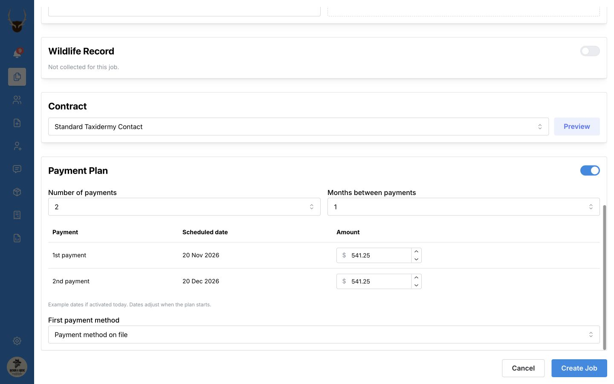

Give your client a way to pay over time. A payment plan splits a new job into scheduled instalments and uses a saved payment method to collect payments through **MountMonitor Payments**.

Set up the plan while creating the job. The ordinary job editor does not let you add a new plan to a job that was saved without one.

## Before you start

- Complete [MountMonitor Payments setup](/payments/set-up-payments).
- Make sure payment plans are available on your account and enabled under **Settings → Job Form**.
- Agree the payment amounts and timing with your client. If you require a contract signature, have the appropriate contract ready.

## Set the schedule on a new job

1. On the jobs board, select **New Job**.
2. Choose the client and add the mounts and services, including their prices and tax settings. Check the job total.
3. Find **Payment Plan** near the bottom of the form and turn it on.
4. Choose **Number of payments** and **Months between payments**.
5. Review the schedule and each **Amount**. You can adjust amounts during setup; check the whole schedule again after a change.
6. Choose **First payment method** using the options below.
7. Review any contract or other required information, then select **Create Job**.

  

The dates shown during creation are examples. The actual dates adjust when the plan starts. The number of payments includes the first payment.

For example, a job total of **1,000** split into four equal payments is **250** per instalment before any added payment-processing fees.

### Choose how to take the first payment

| First payment method | What happens |
| --- | --- |
| **Different card than on file** | Collect the first payment separately—for example, using your card reader—then use the saved method for future instalments. |
| **Payment method on file** | The plan uses the saved method for its first payment as well as later instalments. Completing setup can start collection of that first payment. |
| **Cash**, **Check**, or **Other** | Record the first payment as received, then save a method for the future scheduled payments. |

A plan's initial payment is part of its schedule. Do not add a separate ordinary deposit on top of the plan.

## Complete the requirements after saving

Creating the job is only part of setup. In **Collect Requirements**, choose **In-Person Now** or **Via Client Portal** to complete the outstanding items.

### When the client is with you

1. Select **In-Person Now**.
2. Complete any required signature using **Open Contract for Signing**, and any other document requirements shown.
3. If **Initial Payment** appears, collect or log that first instalment. For an in-person card payment, use the card reader through MountMonitor Payments.
4. If **Payment Method** appears, select **Set Up Payment Method** and let the client complete the secure payment-method form.
5. Wait for **All requirements completed!**, then select **Complete**.

If the first payment uses **Payment method on file**, completing the saved-method setup can trigger that payment. Confirm the agreed amount with the client before they finish.

### When the client will complete it later

Select **Via Client Portal**, choose an available delivery method, and select **Send**. This sends the client a link to complete the outstanding requirements.

If you choose **Handle Later on Job Page**, return to the job's **Requirements Due** action to finish setup. The **Details** tab also lists outstanding requirements.

## Check the saved plan

Open the job's **Billing** tab and find **Payment Plan**. Review each instalment's amount, due date, and status, and check the first payment once it has been processed.

A first payment received in cash or on a different card does not replace the saved method needed for future collection. A required signature or missing method can leave setup incomplete.

## If Payment Plan is missing

Check that you are creating a new job, payment plans are enabled in **Settings → Job Form**, and MountMonitor Payments is connected. Account or subscription access can also affect availability. [Contact support](mailto:contact@mountmonitor.com) if you need help checking your setup.

## Related guides

- [Manage a payment plan](/payments/manage-a-payment-plan)
- [Take a payment](/payments/record-a-payment)
- [Fix a payment problem](/payments/troubleshoot-a-payment)
