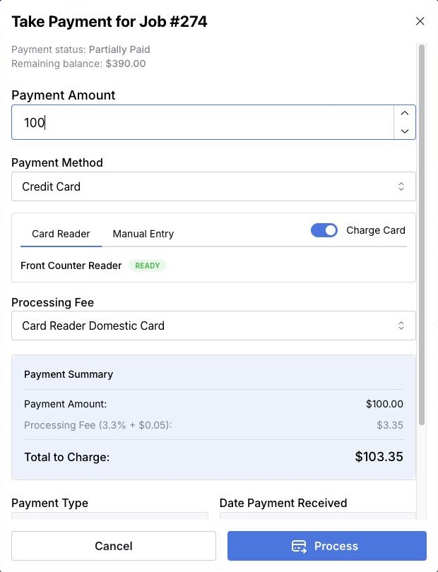
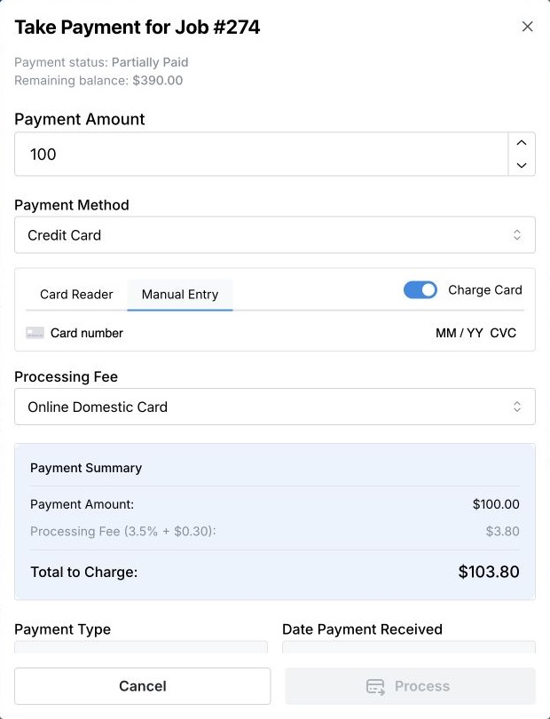
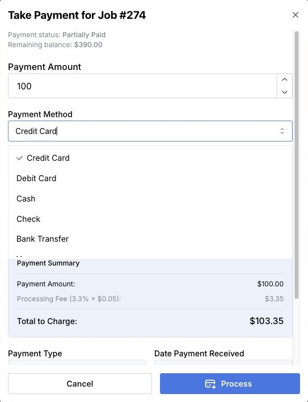
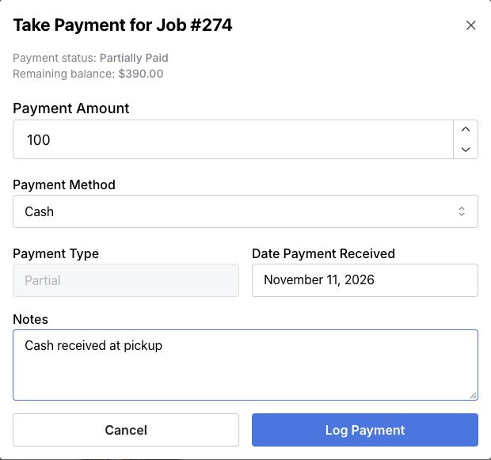
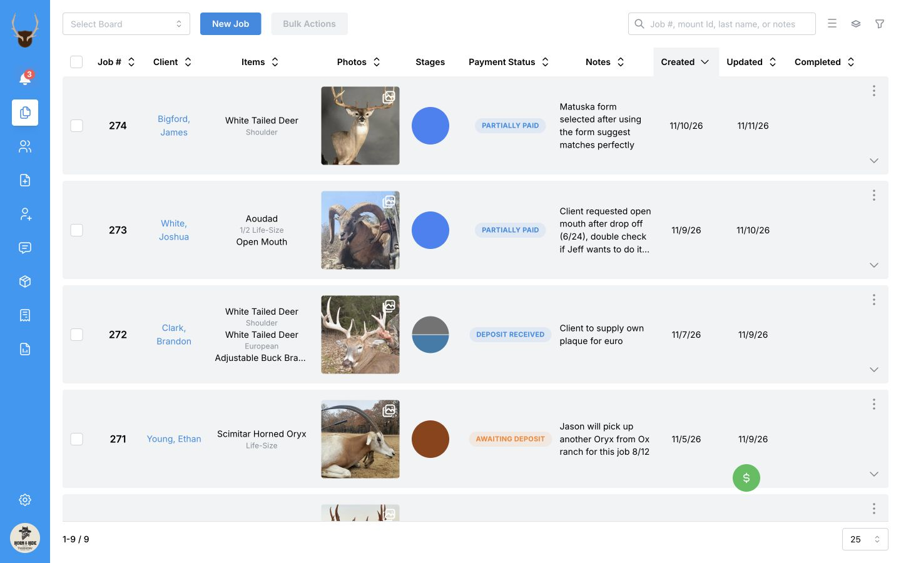

From the first deposit to the final balance, take payments right in MountMonitor. With [**MountMonitor Payments**](/payments/overview#mountmonitor-payments) and our card readers, you can collect a card payment in person and have it saved straight to the job.

You can also log cash, bank transfers, or other payments you’ve received, so the job’s balance and payment history stay up to date.

## Open Take Payment from the jobs board

1. On the jobs board, find the job. Check the job number and client.
2. Open the **three-dot menu (⋮)** at the right of that job’s row.
3. Select **Take Payment**.
4. Check the job number in the window heading and the **Remaining balance**.

## Take a payment with a credit card

Use your card reader to take a payment in person through MountMonitor Payments. Before you start, [set up MountMonitor Payments](/payments/set-up-payments) and [connect your card reader](/payments/set-up-a-card-reader).

  

1. Enter the **Payment Amount** you want applied to the job. Check any deposit or balance amount already filled in.
2. Select **Credit Card** or **Debit Card** under **Payment Method**.
3. If you have multiple card readers, choose the one you are using for this payment.
4. If you pass processing fees on to the client, check that a fee is selected under **Processing Fee**. A fee is selected by default.
5. Select **Process**. The reader lights up with the amount to pay. The client can tap, swipe, or insert their card and follow the prompts to complete the payment.
6. Keep the window open until **Payment successfully taken!** appears and the window closes.

MountMonitor charges the card, saves the payment to the job, and updates its balance and payment status, all in one go.

If the reader can't connect, follow [Troubleshoot your card reader](/payments/set-up-a-card-reader#troubleshoot-your-card-reader).

### Processing fees

If you pass processing fees on to the client, the fee appears in **Payment Summary** and is added to the job’s billing details when the payment is saved.

<Note>
We can help you set up processing fees and custom rates for your shop. [Contact support](mailto:contact@mountmonitor.com), or see [Set up payment processing fees](/payments/set-up-processing-fees).
</Note>

## Enter card details manually

You can also charge a card through MountMonitor Payments by entering its details in **Manual Entry**.

Payments taken by entering card details manually count as **online payments** and use online processing rates. These differ from card-reader rates.

  

1. In **Take Payment**, enter the **Payment Amount** and choose **Credit Card** or **Debit Card**.
2. Select **Manual Entry**.
3. Enter the card number, expiry date, and CVC in the payment fields.
4. If you pass processing fees on to the client, check that a fee is selected under **Processing Fee**. The online payment fee is selected by default.
5. Select **Process** and wait for the success confirmation.

## Other payment methods

Use **Payment Method** in the same window to choose how the client paid. Scroll the list to see all payment methods.

  

### Record cash or another payment already received

You can also record cash, checks, bank transfers, Venmo, PayPal, or other money you have received. This keeps the job’s payment history and balance up to date.

1. Open **Take Payment** from the job’s three-dot menu.
2. Enter the amount received under **Payment Amount**.
3. Choose **Cash**, **Check**, **Bank Transfer**, **Venmo**, **PayPal**, or **Other** under **Payment Method**.
4. Set **Date Payment Received** and add a useful reference under **Notes**, such as a check number or bank-transfer reference.
5. Check the details, then select **Log Payment**.
6. Wait for the success confirmation and check the remaining balance.

  

Selecting a non-card method turns off card charging and clears the card-processing fee. **Log Payment** records money already received; it does not collect money from a bank account or another payment service.

### A card payment taken elsewhere

Choose **Credit Card** or **Debit Card**, then turn **Charge Card** off. Check any fee shown, the received date, and the amount, then select **Log Payment**. With **Charge Card** on, **Process** starts a new charge.

## Point of sale

Take a job payment wherever you are in MountMonitor. The floating green **$** button puts **MountMonitor Payments** within reach on every screen, so you can choose a job and take its payment without returning to the jobs board.

You can also turn an iPad at the counter into a dedicated point-of-sale station. Keep MountMonitor open with a connected card reader, ready to take job payments or one-off sales.

  
  <svg viewBox="0 0 1440 900" aria-hidden="true" style={{ position: "absolute", inset: 0, width: "100%", height: "100%", pointerEvents: "none" }}>
    <path d="M 1000 605 Q 1130 625 1170 737" fill="none" stroke="white" strokeWidth="14" strokeLinecap="round" />
    <path d="M 1000 605 Q 1130 625 1170 737" fill="none" stroke="#ef4444" strokeWidth="7" strokeLinecap="round" />
    <path d="M 1148 723 L 1174 739 L 1175 710" fill="none" stroke="white" strokeWidth="14" strokeLinecap="round" strokeLinejoin="round" />
    <path d="M 1148 723 L 1174 739 L 1175 710" fill="none" stroke="#ef4444" strokeWidth="7" strokeLinecap="round" strokeLinejoin="round" />
  </svg>

[Set up and use point of sale](/payments/take-a-job-payment-with-pos) to turn on the quick button and put it where it suits you. For a sale with no job, see [Take a one-off payment](/payments/take-a-one-off-payment).

## Check the result

Open the job’s billing section and check the saved payment, remaining balance, and payment status. **Payment Type** is filled in automatically; an amount that differs from the requested deposit may be classified as a partial payment.

For example, a payment of 100 against a balance of 390 leaves 290 to pay before any added fees or tax. A payment amount must be greater than zero and cannot exceed the job’s remaining balance.

If the card appears to have been charged but the job did not update, check its billing records and [transactions](/payments/view-transactions-and-payouts) before retrying. Contact [support](mailto:contact@mountmonitor.com) if you cannot confirm the result. If connected accounting software reports a sync error, check the payment before correcting the accounting record.

## Edit a payment or return money later

Review the saved payment in the job’s billing section. A card charged through MountMonitor is linked to its card transaction. Cash and other recorded payments track money handled through their original payment method.

Use [Correct a payment record](/payments/correct-a-payment-record) for a recording mistake, or [Refund a payment](/payments/refund-a-payment) when returning money. Changing a record does not return money to a card. Available actions depend on how the payment was taken.

## If Take Payment is missing

The jobs-board shortcut requires permission to edit jobs and MountMonitor Payments to be connected and enabled. It is not shown for pending jobs or jobs with no remaining balance.
