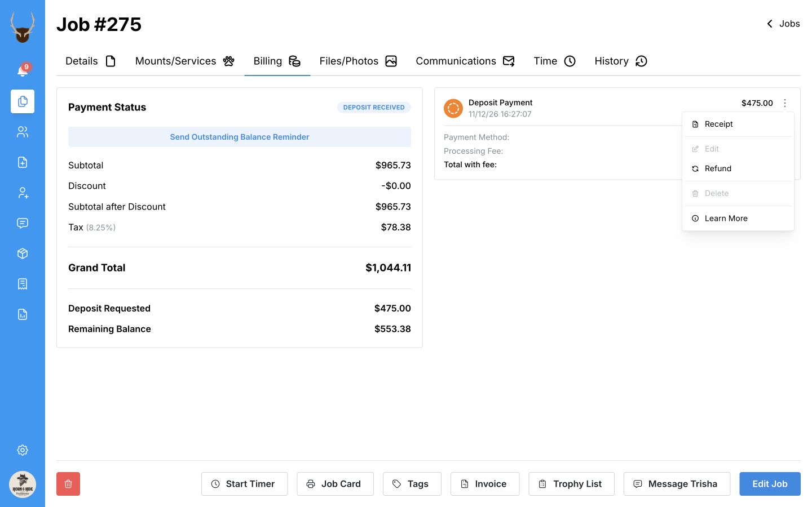
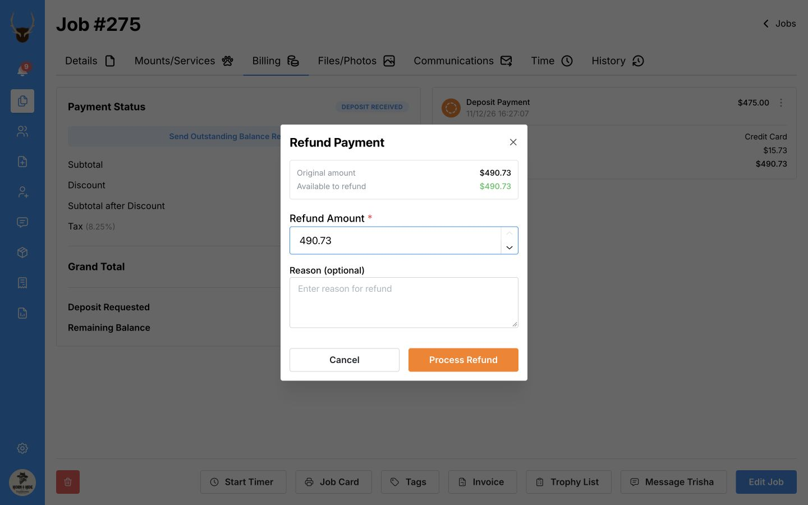

Return all or part of a job payment and keep the job's balance up to date. For payments taken through **MountMonitor Payments**, the refund goes back to the original payment method.

## Open the payment you want to refund

1. Open the job from your jobs board.
2. Select the **Billing** tab.
3. Find the payment you want to refund. Check its date, amount, and payment method.
4. Open the **three-dot menu (⋮)** on that payment and select **Refund**.

  
  <svg viewBox="0 0 1440 900" aria-hidden="true" style={{ position: "absolute", inset: 0, width: "100%", height: "100%", pointerEvents: "none" }}>
    <path d="M 1080 299 L 1208 299" fill="none" stroke="white" strokeWidth="7" strokeLinecap="round" strokeLinejoin="round" />
    <path d="M 1080 299 L 1208 299" fill="none" stroke="#ef4444" strokeWidth="3.5" strokeLinecap="round" strokeLinejoin="round" />
    <path d="M 1194 290 L 1208 299 L 1194 308" fill="none" stroke="white" strokeWidth="7" strokeLinecap="round" strokeLinejoin="round" />
    <path d="M 1194 290 L 1208 299 L 1194 308" fill="none" stroke="#ef4444" strokeWidth="3.5" strokeLinecap="round" strokeLinejoin="round" />
  </svg>

The **Refund Payment** window shows the **Original amount** and **Available to refund**. If you have refunded part of this payment before, it also shows **Already refunded**.

## Refund a payment through MountMonitor Payments

Use these steps for a card payment you collected through MountMonitor, including one taken with a reader or by entering the card details.

1. Check the payment details in **Refund Payment**. When available, the window shows the card or account the refund will return to.
2. Under **Refund Amount**, enter how much you want to return. For a full refund, enter the amount shown under **Available to refund**. This can include processing fees and tax that were part of the payment.
3. Add a **Reason (optional)** to help your team understand the refund later.
4. Review the amount, then select **Process Refund**.
5. Wait for **Payment Refunded**, then check the updated payment and remaining balance in **Billing**.

  
  <svg viewBox="0 0 1440 900" aria-hidden="true" style={{ position: "absolute", inset: 0, width: "100%", height: "100%", pointerEvents: "none" }}>
    <path d="M 1060 641 L 934 641" fill="none" stroke="white" strokeWidth="7" strokeLinecap="round" strokeLinejoin="round" />
    <path d="M 1060 641 L 934 641" fill="none" stroke="#ef4444" strokeWidth="3.5" strokeLinecap="round" strokeLinejoin="round" />
    <path d="M 947 632 L 934 641 L 947 650" fill="none" stroke="white" strokeWidth="7" strokeLinecap="round" strokeLinejoin="round" />
    <path d="M 947 632 L 934 641 L 947 650" fill="none" stroke="#ef4444" strokeWidth="3.5" strokeLinecap="round" strokeLinejoin="round" />
  </svg>

The refund is sent to the original payment method. The client's bank determines when it appears in their account. A recent refund may appear as a change to the original charge on their statement. [Stripe's refund guidance](https://support.stripe.com/questions/how-long-refunds-take-to-process)

### Return part of a payment

Enter the amount you want to return in **Refund Amount**. For example, enter **50** to return 50 from a payment of 200.

The payment is marked **Partially Refunded**. You can refund more later, up to the amount still shown under **Available to refund**.

## Refund cash or a payment taken elsewhere

For cash, a bank transfer, or a card payment taken outside MountMonitor, arrange the return of the money through the method you used to receive it.

Then open the payment's **three-dot menu (⋮) → Refund** in **Billing**. Enter the amount you returned and an optional reason, then select **Process Refund** to record it against the job.

<Note>
For these payments, **Process Refund** records the refund in MountMonitor. You still need to return the money to the client yourself.
</Note>

## Check the job after a refund

- The payment shows **Refunded** or **Partially Refunded**.
- The job's paid amount, remaining balance, and payment status are recalculated.
- Open the payment's **three-dot menu (⋮) → View History** to see the refund amount, reason, date, and team member who recorded it.

For example, a job totalling 500 with 200 paid has 300 remaining. Refunding 50 leaves 150 paid and 350 remaining, assuming there are no processing fees.

If you are also cancelling work or changing its price, update the mounts or services on the job to match what the client still owes.

### Processing fees

If the payment has a linked processing-fee line on the job, a partial refund reduces that line proportionally. A full refund removes it, and the job's totals are recalculated.

Stripe keeps the original payment processing fees when a payment is refunded. [Stripe's explanation of refund fees](https://support.stripe.com/questions/understanding-fees-for-refunded-payments)

### Payments split across jobs

Open the job containing the portion you want to refund. **Available to refund** applies to that job's portion. If you need to return money allocated to other jobs too, refund their portions from those jobs.

### Payments charged in another currency

If **Refund is in** appears, check the currency and the converted refund amount shown in the window. Enter **Refund Amount** in the job's currency. MountMonitor uses the payment's saved conversion rate for the refund, and the client's bank handles any further currency conversion.

### If you use QuickBooks

MountMonitor updates the linked QuickBooks payment or invoice deposit to reflect the refund. The payment window explains the update when the job is linked to QuickBooks.

If you see **Payment Refunded — QuickBooks Update Incomplete**, the refund has been saved. Follow the message to correct the accounting update, or contact support for help.

## If you need help

**Refund is unavailable.** A fully refunded payment has no amount left to return. Payments linked to a payment plan have refund restrictions. The payment's **Learn More** option explains which actions are available.

**The amount is rejected.** Enter an amount greater than zero and no higher than **Available to refund**.

**An error appears after you select Process Refund.** Check the payment's history and any refund confirmation before trying again. If the result is unclear, contact support so we can check it before you submit another refund.

**The client cannot see the refund yet.** Their bank may still be processing it. Contact support if you need help checking the refund's progress.

[Contact MountMonitor support](mailto:contact@mountmonitor.com) with the job number, amount, time, and any message shown.

## Related guides

- [Take a payment](/payments/record-a-payment)
- [Correct a payment record](/payments/correct-a-payment-record)
- [Manage a payment plan](/payments/manage-a-payment-plan)
