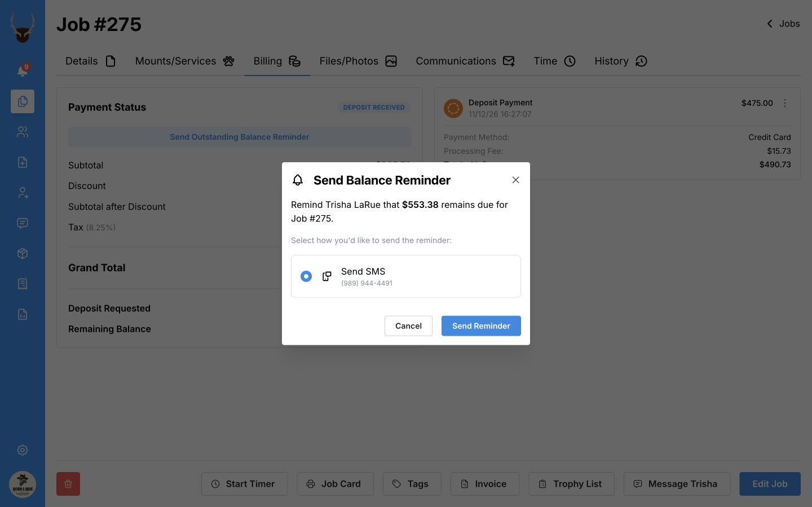

Let clients pay when it suits them, without a trip to the shop. With **MountMonitor Payments**, a payment reminder or invoice can take them to their Client Portal to pay online.

Before sending a request, [set up MountMonitor Payments](/payments/set-up-payments) and check that the job is assigned to the right client with current contact details.

## Send a deposit or balance reminder

1. Open the job and select **Billing**.
2. Select **Send Deposit Reminder** when you are waiting for a deposit, or **Send Outstanding Balance Reminder** for the amount still owing.
3. Check the job number, client, and amount in the reminder window.
4. Choose **Send SMS**, **Send Email**, or **Send SMS & Email**, depending on the options shown. Check the destination details.
5. Select **Send Reminder** and check the result shown.

  
  <svg viewBox="0 0 1440 900" aria-hidden="true" style={{ position: "absolute", inset: 0, width: "100%", height: "100%", pointerEvents: "none" }}>
    <path d="M 1060 579 L 934 579" fill="none" stroke="white" strokeWidth="7" strokeLinecap="round" strokeLinejoin="round" />
    <path d="M 1060 579 L 934 579" fill="none" stroke="#ef4444" strokeWidth="3.5" strokeLinecap="round" strokeLinejoin="round" />
    <path d="M 947 570 L 934 579 L 947 588" fill="none" stroke="white" strokeWidth="7" strokeLinecap="round" strokeLinejoin="round" />
    <path d="M 947 570 L 934 579 L 947 588" fill="none" stroke="#ef4444" strokeWidth="3.5" strokeLinecap="round" strokeLinejoin="round" />
  </svg>

The reminder goes to the client through the channel you selected and includes access to their portal. Sending it does not charge the client or mark the job as paid.

The available reminder changes as the deposit is covered. If no reminder is shown, check that the job has a balance and the client has a supported phone number or email address. SMS availability depends on the phone number; add an email address if the SMS option is unavailable.

## Send an invoice instead

1. Open the job and select **Invoice**.
2. Review the invoice and the client's email address on their record.
3. Select **Email Invoice** and wait for the sending result.

This sends the invoice to the email saved for that client. To give someone a printed invoice with portal access, turn on **Include QR code for client portal** under **Settings → Invoicing**, then save the settings before printing the invoice.

An invoice or portal link is useful when the client wants to review the work and balance before paying. For a quick follow-up on an outstanding amount, use the reminder above.

## What the client does

The client opens their portal link and chooses **Pay Now** for the job. They review the **Payment Amount**, any processing fee, and the total, then select **Proceed to Payment** and complete the checkout.

**Card** is available through MountMonitor Payments. **Bank Transfer** may also be offered where supported. The amount and minimum payment shown depend on the job's deposit and remaining balance. Some jobs require a signature or payment-method setup before **Pay Now** is available.

If the job is billed through QuickBooks' own hosted invoice, its **Pay Now** route opens that invoice's payment page instead.

## Check that payment arrived

Return to the job's **Billing** tab and check the saved payment and remaining balance. You can also check [Transactions](/payments/view-transactions-and-payouts). A sent reminder, an opened link, or an unfinished checkout is not a completed payment.

Bank payments can remain processing while they clear. If the client says they paid and the job has not updated, check the transaction before asking them to pay again.

## If the client needs help

- **No message received:** Check the saved address or phone number and ask the client to check their junk folder for email.
- **No Pay Now button:** Check payment setup, the job's balance, and any outstanding signature or payment-method requirements.
- **The amount looks wrong:** Review the job's charges, payments, and fees before sending another request.

[Contact support](mailto:contact@mountmonitor.com) if the client cannot complete payment. Include the job number and the message shown.

## Related guides

- [Take a payment in the shop](/payments/record-a-payment)
- [Understand deposits and balances](/payments/understand-deposits-and-balances)
- [Fix a payment problem](/payments/troubleshoot-a-payment)
