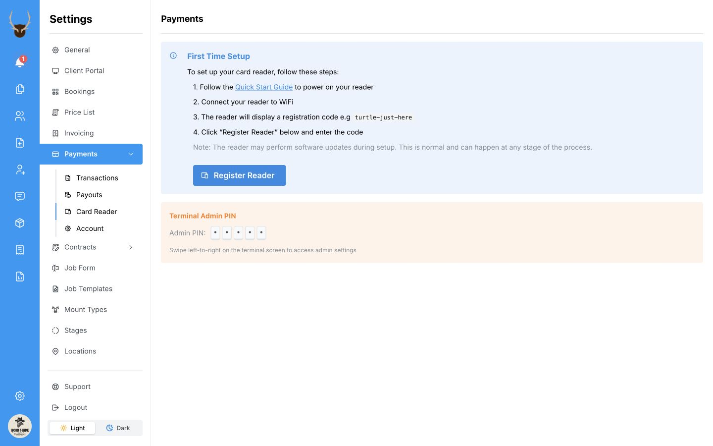
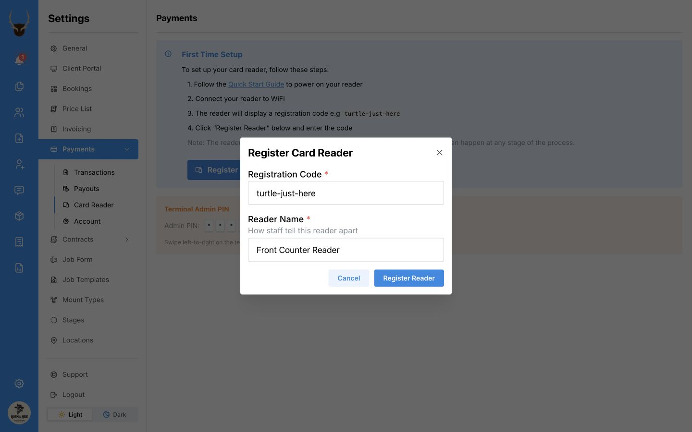
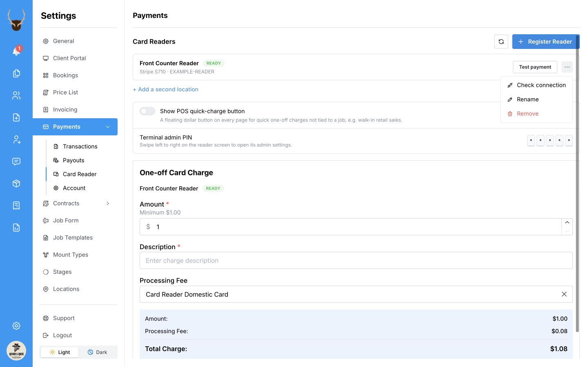
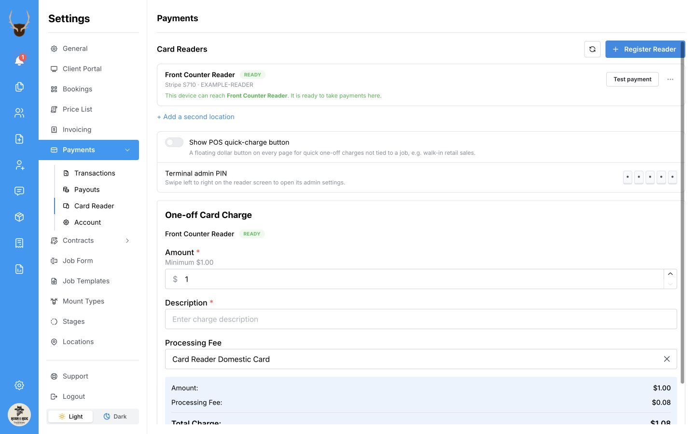

Get your reader ready for the next client at the counter. Once it is set up, you can take card payments through **MountMonitor Payments** and have job payments saved straight to the job.

These steps cover the **Stripe Reader S710**. If you take payments on a computer, we recommend **Google Chrome** or **Microsoft Edge**.

## Before you start

Have these ready:

- A completed [MountMonitor Payments account](/payments/set-up-payments).
- Your card reader and its supplied charger.
- Your shop’s Wi-Fi name and password.
- The computer, iPad, or phone you will use to take payments, connected to the same shop Wi-Fi as the reader.

## Power on the reader and connect to Wi-Fi

1. Connect the reader to its supplied charger. Hold the **power button** on the right side for 2–3 seconds, until the screen turns on.
2. Follow the reader’s prompts to connect to your shop Wi-Fi. Keep it plugged in while it finishes any software updates.
3. Connect the device running MountMonitor to the same Wi-Fi network.

See the [Stripe S710 quick-start sheet](https://docs.stripecdn.com/s710-product-sheet.pdf) for button locations and charging details.

To change the reader’s Wi-Fi later, swipe right from the left edge of its screen, open **Settings**, and enter its admin passcode. In **Network settings**, select your network and enter the password. See [Stripe’s reader network instructions](https://support.stripe.com/questions/access-advanced-network-settings-on-terminal-smart-readers).

MountMonitor shows the default **Terminal admin PIN** under **Settings → Payments → Card Reader**. Use your custom passcode if you have changed it.

## Open Card Reader settings

1. In MountMonitor, open **Settings**.
2. Select **Payments**, then **Card Reader**.
3. Look for your reader in the list.

<Tip>
If your reader is already listed, skip registration and go to [Check the reader from your device](#check-the-reader-from-your-device).
</Tip>

If no reader is registered, you will see **First Time Setup**:

  
  <svg viewBox="0 0 1440 900" aria-hidden="true" style={{ position: "absolute", inset: 0, width: "100%", height: "100%", pointerEvents: "none" }}>
    <path d="M 766 456 Q 649 454 565 357" fill="none" stroke="white" strokeWidth="14" strokeLinecap="round" strokeLinejoin="round" />
    <path d="M 766 456 Q 649 454 565 357" fill="none" stroke="#ef4444" strokeWidth="7" strokeLinecap="round" strokeLinejoin="round" />
    <path d="M 589 362 L 563 354 L 571 380" fill="none" stroke="white" strokeWidth="14" strokeLinecap="round" strokeLinejoin="round" />
    <path d="M 589 362 L 563 354 L 571 380" fill="none" stroke="#ef4444" strokeWidth="7" strokeLinecap="round" strokeLinejoin="round" />
  </svg>

## Register your reader if needed

1. On the reader, swipe right from the left edge, open **Settings**, and enter the admin passcode. Select **Generate a Pairing Code** and keep the code on screen. Use this code in MountMonitor; the three-word code in the screenshot is an example.
2. In MountMonitor’s **Card Reader** settings, select **Register Reader**.
3. Under **Registration Code**, enter the code shown on the reader.
4. Under **Reader Name**, enter a name your team will recognise, such as **Front Counter Reader** or **Back Bench**.
5. If **Location** appears, choose the shop or site where the reader will stay.
6. Select **Register Reader**.

  
  <svg viewBox="0 0 1440 900" aria-hidden="true" style={{ position: "absolute", inset: 0, width: "100%", height: "100%", pointerEvents: "none" }}>
    <path d="M 1050 697 Q 930 703 853 593" fill="none" stroke="white" strokeWidth="14" strokeLinecap="round" strokeLinejoin="round" />
    <path d="M 1050 697 Q 930 703 853 593" fill="none" stroke="#ef4444" strokeWidth="7" strokeLinecap="round" strokeLinejoin="round" />
    <path d="M 874 602 L 851 591 L 854 617" fill="none" stroke="white" strokeWidth="14" strokeLinecap="round" strokeLinejoin="round" />
    <path d="M 874 602 L 851 591 L 854 617" fill="none" stroke="#ef4444" strokeWidth="7" strokeLinecap="round" strokeLinejoin="round" />
  </svg>

The window closes and the reader appears in your list. If the list has not updated, use the **Refresh reader status** button beside **Register Reader**.

## Check the reader from your device

Run this check on the computer, iPad, or phone you will use to take payments.

1. Find your reader in **Settings → Payments → Card Reader**.
2. Open its **three-dot menu (⋯)**.
3. Select **Check connection**.

  
  <svg viewBox="0 0 1440 900" aria-hidden="true" style={{ position: "absolute", inset: 0, width: "100%", height: "100%", pointerEvents: "none" }}>
    <path d="M 1038 265 Q 1121 218 1233 209" fill="none" stroke="white" strokeWidth="14" strokeLinecap="round" strokeLinejoin="round" />
    <path d="M 1038 265 Q 1121 218 1233 209" fill="none" stroke="#ef4444" strokeWidth="7" strokeLinecap="round" strokeLinejoin="round" />
    <path d="M 1213 198 L 1236 209 L 1215 223" fill="none" stroke="white" strokeWidth="14" strokeLinecap="round" strokeLinejoin="round" />
    <path d="M 1213 198 L 1236 209 L 1215 223" fill="none" stroke="#ef4444" strokeWidth="7" strokeLinecap="round" strokeLinejoin="round" />
  </svg>

A successful check shows a green message confirming that this device can reach the reader and is ready to take payments.

  

**Ready** means the reader is online. **Check connection** confirms that the device you are using can reach it. MountMonitor connects to the reader when you take a payment.

<Note>
**Check connection** does not charge a card. The separate **Test payment** button takes a real card payment and is optional for setup.
</Note>

## If you have more than one reader

Give each reader a clear name. Select **Use on this device** beside the reader you want that computer, iPad, or phone to use. Each device remembers its choice, and you can choose another reader when taking a payment.

If you use several shop sites, select the appropriate **Location** when registering a reader. These are the sites where your card readers are kept.

## Troubleshoot your card reader

If you see **Could not communicate with the Reader**, start with the checks below. A reader can show **Ready** even when the computer at the counter can't reach it.

### Start with power and Wi-Fi

1. Make sure the reader is on. If it's updating, let it finish.
2. Check that your reader and the computer or iPad running MountMonitor are on the same shop Wi-Fi. Use your regular shop network if one of them is on guest Wi-Fi.
3. In **Settings → Payments → Card Reader**, refresh the reader's status and run [**Check connection**](#check-the-reader-from-your-device). You can do this without charging a card.

If the reader is taking a payment on another device, wait until that payment finishes before checking again.

### Let Chrome or Edge reach your reader

If Chrome or Edge asks to connect to devices on your local network while you're in MountMonitor, select **Allow**. This lets MountMonitor reach the card reader over your shop Wi-Fi. If you dismissed or blocked the prompt, you can change the permission for MountMonitor.

1. In your MountMonitor tab, select the icon just to the left of the web address.
2. In Chrome, select **Site settings**. In Edge, select **Permissions for this site**.
3. Find **Local network access** or **Local network** and set it to **Allow** for MountMonitor.
4. Return to the MountMonitor tab, reload the page, and run **Check connection** again.

[Chrome site permissions](https://support.google.com/chrome/answer/114662?hl=en) · [Edge local network access](https://support.microsoft.com/en-us/edge/control-a-website-s-access-to-the-local-network-in-microsoft-edge)

### If Chrome still can't find the reader

Some internet routers have trouble looking up the reader's address, even when both devices are on the same Wi-Fi. If you manage the computer yourself, you can try Google's address lookup service in Chrome.

1. In Chrome, open **Settings → Privacy and security → Security**.
2. Under **Use secure DNS**, choose **Google (Public DNS)** as the provider.
3. Reload MountMonitor and run **Check connection** again.

If the setting is unavailable or someone else manages the computer, ask them to check the connection. [Google's Secure DNS instructions](https://support.google.com/chrome/answer/10468685?hl=en) · [Stripe's reader address lookup guidance](https://support.stripe.com/questions/fix-dns-errors-on-stripe-terminal-javascript-sdk?locale=en-GB)

### If it works on another device

If you have another computer or iPad on the shop Wi-Fi, open MountMonitor there and run **Check connection**. If it works, you can use that device at the counter. If a client already tried to pay, [check the payment result](/payments/record-a-payment#check-the-result) before trying the charge again.

If the first computer still can't connect, its antivirus or web protection may be blocking the reader. Tell us which security software you use. If someone looks after your computers, they can check whether it blocked the reader and allow that specific connection while keeping protection on. [Stripe's network requirements for card readers](https://support.stripe.com/questions/my-point-of-sale-application-cannot-connect-to-the-terminal-smart-reader-using-terminal-sdks)

### If you're setting up the reader for the first time

- **Registration code rejected.** Get a new pairing code from the reader. If the reader already appears in MountMonitor, use that entry and run **Check connection**.
- **Reader status could not be checked.** Reload the page and refresh the reader list before trying to register again.

### Still having trouble?

[Contact MountMonitor support](mailto:contact@mountmonitor.com) and we'll help you get your reader connected. If you can, send a screenshot of the message and tell us which computer and browser you're using and whether another device can connect.

## Take your first payment

Follow [Take a payment](/payments/record-a-payment) to collect a deposit, part payment, or final balance on a job.

For quick access anywhere in MountMonitor, turn on the [POS quick button](/payments/take-a-job-payment-with-pos). For a sale with no job, see [Take a one-off payment](/payments/take-a-one-off-payment).
