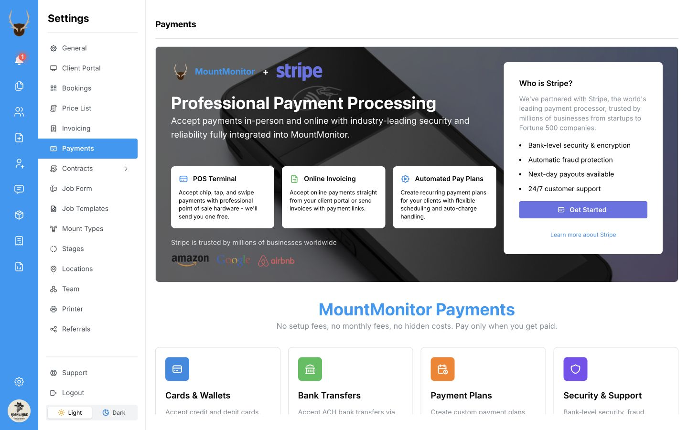
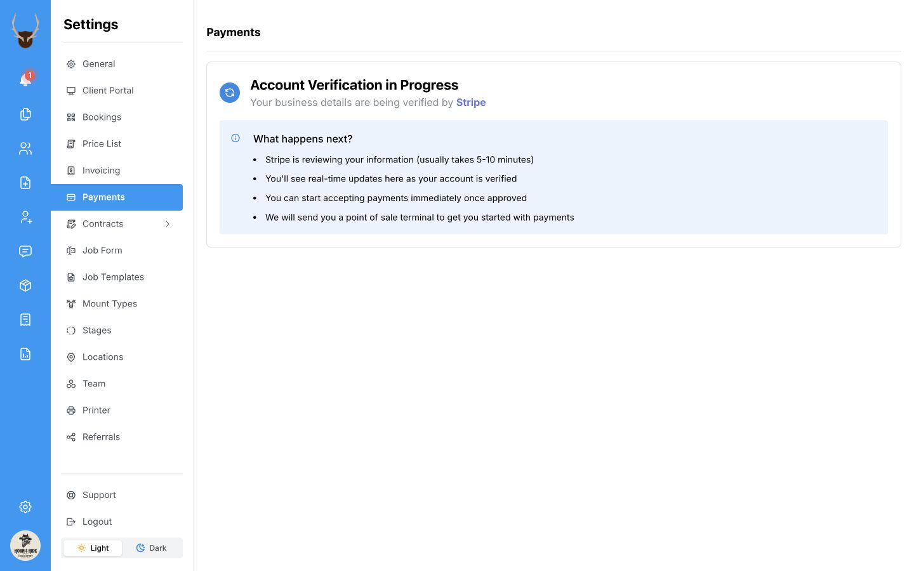

Get ready to take deposits and balances right in MountMonitor. Set up **MountMonitor Payments** for card-reader payments in person, manual card entry, and online payments through your Client Portal.

We work with **Stripe** to process payments and send payouts to your bank account. You complete your payment account setup inside MountMonitor.

## Before you start

Have your business details and the bank details for receiving payouts ready. The setup form guides you through the information it needs and any verification steps.

## Start your payment account setup

1. Open **Settings**.
2. Select **Payments**.
3. Select **Get Started** to begin your payment account setup.

  
  <svg viewBox="0 0 1440 900" aria-hidden="true" style={{ position: "absolute", inset: 0, width: "100%", height: "100%", pointerEvents: "none" }}>
    <path d="M 970 565 Q 1140 565 1204 452" fill="none" stroke="white" strokeWidth="14" strokeLinecap="round" />
    <path d="M 970 565 Q 1140 565 1204 452" fill="none" stroke="#ef4444" strokeWidth="7" strokeLinecap="round" />
    <path d="M 1182 466 L 1206 449 L 1205 478" fill="none" stroke="white" strokeWidth="14" strokeLinecap="round" strokeLinejoin="round" />
    <path d="M 1182 466 L 1206 449 L 1205 478" fill="none" stroke="#ef4444" strokeWidth="7" strokeLinecap="round" strokeLinejoin="round" />
  </svg>

## Complete the setup form

1. Follow the screens in the payment account setup form. Check any details already filled in for you.
2. Enter the requested business and account-holder information.
3. Add the bank details requested for receiving payouts.
4. Complete any verification steps and review your information before submitting it.

Use the instructions shown in the form for your account. If more information is requested, complete those items to move your setup forward. [Contact support](mailto:contact@mountmonitor.com) if you need a hand.

## Check your account status

Return to **Settings → Payments** after submitting your details.

If you see **Account Verification in Progress**, your information has been submitted and is being reviewed. Check this screen for updates and complete any requests for more information.

  

Once your account is approved and MountMonitor Payments is enabled, the payment tools become available:

| In Payments settings | What you can do |
| --- | --- |
| **Transactions** | View your card-payment transactions. |
| **Payouts** | Track money being sent to your bank account. |
| **Card Reader** | Set up your reader and turn on the POS quick button. |
| **Account** | Manage your payment account information. |

A client’s payment and a bank payout are separate: the payment records what the client paid; the payout sends funds to your bank. See [Transactions and payouts](/payments/view-transactions-and-payouts).

## Take your first payment

- **Connect your card reader:** When your reader arrives, follow [Set up a card reader](/payments/set-up-a-card-reader). Contact [support](mailto:contact@mountmonitor.com) for help with reader delivery or setup.
- **Set up your processing fees:** We can help you set up fees and custom rates for your shop. See [Set up payment processing fees](/payments/set-up-processing-fees).
- **Take a job payment:** Follow [Take a payment](/payments/record-a-payment) to collect a deposit, part payment, or final balance.
- **Keep payments within reach:** Turn on the [POS quick button](/payments/take-a-job-payment-with-pos) to take payments from anywhere in the app or use an iPad at the counter as a point-of-sale station.

## If something looks different

**Payments is missing from Settings:** Contact [support](mailto:contact@mountmonitor.com) to check access for your account.

**The setup form still asks for information:** Complete the outstanding items shown in the form or the message at the top of Payments settings.

**Your account is approved, but payment tools are missing:** Contact [support](mailto:contact@mountmonitor.com) so we can check that MountMonitor Payments is enabled for your shop.
