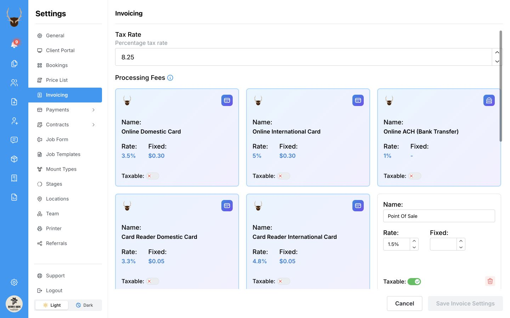
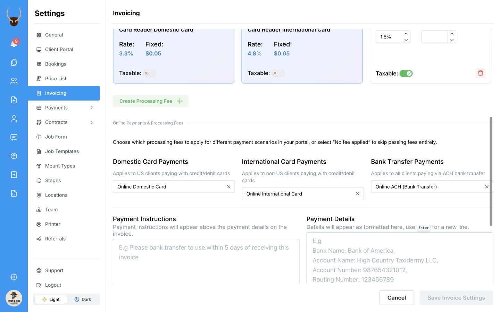

Choose the processing fee added when a client pays, and keep card-reader and online payments using the right settings for your shop.

With **MountMonitor Payments**, the payment form selects an appropriate fee by default. You can check it under **Processing Fee** when taking a payment. We can help you set up custom fees and rates—[contact support](mailto:contact@mountmonitor.com) if you want a hand.

## View your fees

Open **Settings → Invoicing** and find **Processing Fees**.

  

| Setting | What it does |
| --- | --- |
| **Name** | Helps your team identify the fee. The client-facing invoice uses **Processing Fee**. |
| **Rate** | The percentage used to calculate the fee. |
| **Fixed** | An optional fixed amount included in the fee calculation. |
| **Taxable** | Controls whether the fee uses the job's applicable tax settings. |

The blue MountMonitor fee cards are managed fees. Their names and rates are not editable here. Contact support for help with those rates or to arrange custom settings.

The amounts in these screenshots are example account settings. Use the fees shown in your own account.

## Add or edit a custom fee

1. In **Settings → Invoicing**, select **Edit Invoice Settings**.
2. Select **Create Processing Fee** to add a fee, or find an existing custom fee to edit.
3. Enter a distinct **Name**, a **Rate**, and an optional **Fixed** amount. Custom fee names must be longer than two characters, and the rate must be greater than zero.
4. Set **Taxable** to match how your shop needs to handle that fee.
5. Select **Save Invoice Settings**.
6. If **Processing Fees Changed** appears, read it and select **Save new processing fees** to confirm.

To remove a custom fee, use the trash button on its card while editing, then save the settings. Use **Cancel** to leave without saving.

Changing the fee you pass on to a client does not change the processing rates charged to your payment account.

## Choose fees for online payments

Under **Online Payments & Processing Fees**, you can assign fees separately for **Domestic Card Payments**, **International Card Payments**, and **Bank Transfer Payments**, where these options are available.

1. Select **Edit Invoice Settings**.
2. For each payment type, choose the fee you want applied, or **No fee applied** to avoid adding a fee for that type.
3. Select **Save Invoice Settings** and complete any confirmation shown.

  

These assignments apply to supported online payment routes, including the Client Portal. Bank transfer here means the supported online bank-payment option; it does not add a fee to a bank transfer you merely log as received.

## Check the fee when taking a payment

For an in-person payment, use the card reader through [Take a payment](/payments/record-a-payment#take-a-payment-with-a-credit-card). If you pass processing fees on to the client, check that the appropriate fee is selected under **Processing Fee**. The fee is selected by default.

The **Payment Summary** shows the fee and **Total to Charge**. Use those calculated amounts rather than adding the percentage yourself.

Payments taken through **Manual Entry** count as online payments and use online rates, which differ from card-reader rates. See [Enter card details manually](/payments/record-a-payment#enter-card-details-manually).

Logging cash or another non-card payment clears the card-processing fee in the ordinary payment form.

## Where changes apply

Fee edits affect future payments. Existing payments keep the fee details recorded when they were processed; changing today's rate does not rewrite old payment records.

A passed-on payment fee is added to the job as a linked charge. Refunds can reduce or remove that linked fee line. See [Refund a payment](/payments/refund-a-payment#processing-fees).

## If something looks wrong

If you cannot edit settings, check your team permissions. If a fee cannot be selected for an online payment type, check whether it is already assigned to another type.

If you are unsure which fee to use or how to set a custom rate, [contact support](mailto:contact@mountmonitor.com) before taking the payment.
