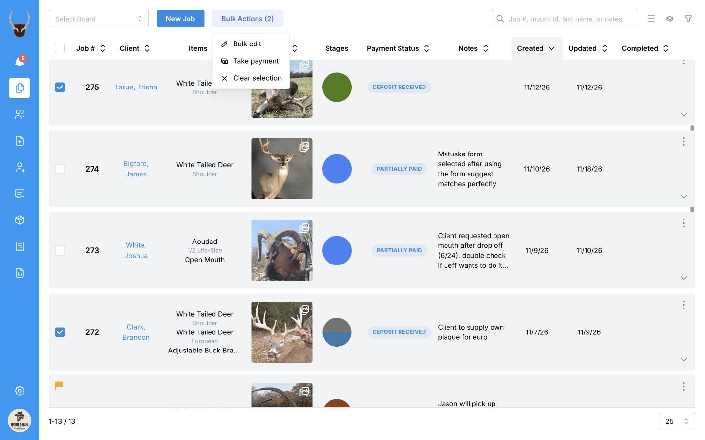
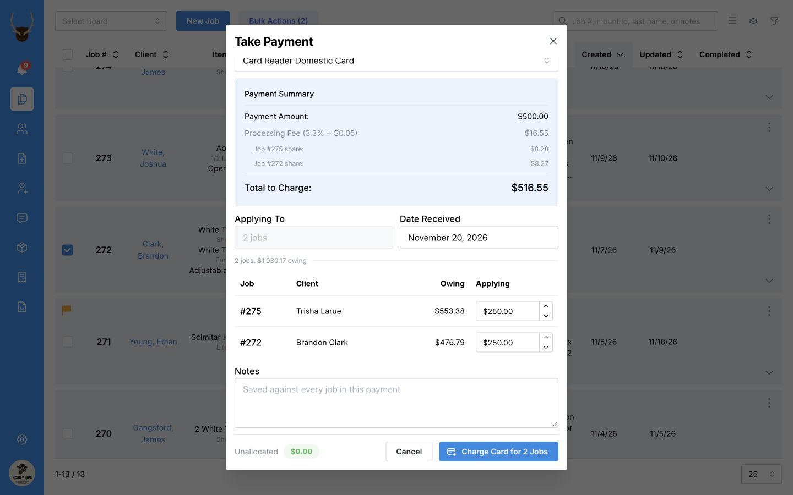

A client collecting several mounts can make one payment, and you can apply the right amount to each job. With **MountMonitor Payments**, you charge one card once and each job gets its own payment entry.

You can include jobs for different clients, such as someone paying for their own job and a friend's. All included jobs must use the same currency and have money owing.

## Choose the jobs

1. On the **jobs board**, select the checkbox beside each job you want included.
2. Open **Bulk Actions**, then select **Take payment**. If your board shows **Take payment** beside the selected jobs instead, select it there.
3. Check the job numbers and clients in **Take Payment**. Read any message explaining why a selected job is not included.

  
  <svg viewBox="0 0 1440 900" aria-hidden="true" style={{ position: "absolute", inset: 0, width: "100%", height: "100%", pointerEvents: "none" }}>
    <path d="M 735 124 L 603 124" fill="none" stroke="white" strokeWidth="7" strokeLinecap="round" strokeLinejoin="round" />
    <path d="M 735 124 L 603 124" fill="none" stroke="#ef4444" strokeWidth="3.5" strokeLinecap="round" strokeLinejoin="round" />
    <path d="M 616 115 L 603 124 L 616 133" fill="none" stroke="white" strokeWidth="7" strokeLinecap="round" strokeLinejoin="round" />
    <path d="M 616 115 L 603 124 L 616 133" fill="none" stroke="#ef4444" strokeWidth="3.5" strokeLinecap="round" strokeLinejoin="round" />
  </svg>

Pending bookings, jobs on payment plans, jobs with nothing outstanding, and jobs in a different currency cannot be included.

## Check how the payment is shared

1. Enter the combined **Payment Amount**, before any added processing fee.
2. Check **Applying** beside each job. MountMonitor spreads the amount across the jobs, up to what each owes.
3. Change an individual **Applying** amount if needed. The remaining money is shared across the other jobs.
4. Check that **Unallocated** is **0.00**. If **Over allocated** appears, reduce the job amounts until they match the payment total.

Use **Pay full outstanding amount** to fill the outstanding total, or **Pay deposits only** when that option is shown. The deposit option fills each job's outstanding deposit rather than spreading the money evenly.

  
  <svg viewBox="0 0 1440 900" aria-hidden="true" style={{ position: "absolute", inset: 0, width: "100%", height: "100%", pointerEvents: "none" }}>
    <path d="M 1155 821 L 1024 821" fill="none" stroke="white" strokeWidth="7" strokeLinecap="round" strokeLinejoin="round" />
    <path d="M 1155 821 L 1024 821" fill="none" stroke="#ef4444" strokeWidth="3.5" strokeLinecap="round" strokeLinejoin="round" />
    <path d="M 1037 812 L 1024 821 L 1037 830" fill="none" stroke="white" strokeWidth="7" strokeLinecap="round" strokeLinejoin="round" />
    <path d="M 1037 812 L 1024 821 L 1037 830" fill="none" stroke="#ef4444" strokeWidth="3.5" strokeLinecap="round" strokeLinejoin="round" />
  </svg>

For example, a payment of **500** can apply **250** to each of two jobs. You can change that to **300** and **200** if that is what the client wants. Neither job can receive more than it owes.

## Take one card payment

1. Choose **Credit Card** or **Debit Card** and use **Charge Card** with **Card Reader**.
2. If you have multiple readers, choose the one the client will use.
3. If **Paid By** appears, select whose card is paying. Choose **Someone else** if the payer is not one of the listed clients.
4. If you pass processing fees on to the client, check the selected **Processing Fee**. A fee is selected by default when configured.
5. Check **Payment Summary**, including each job's fee share and **Total to Charge**.
6. Select **Charge Card for … Jobs**. The reader shows the amount; the client taps, swipes, or inserts their card and follows the prompts.
7. Wait for **Payment split successfully**, then check the payment and balance on each included job.

The fee is calculated for the combined payment and shared between jobs. A fixed fee is not added in full to every job.

**Manual Entry** is also available when supported. Manually entered card payments count as online payments and use online processing rates. See [Take a payment](/payments/record-a-payment#enter-card-details-manually).
