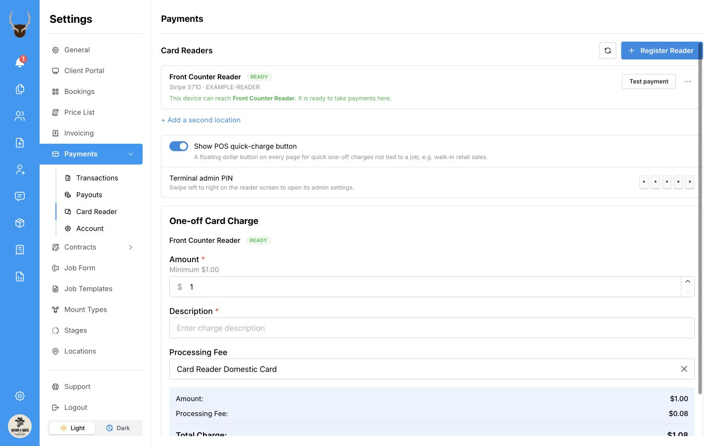
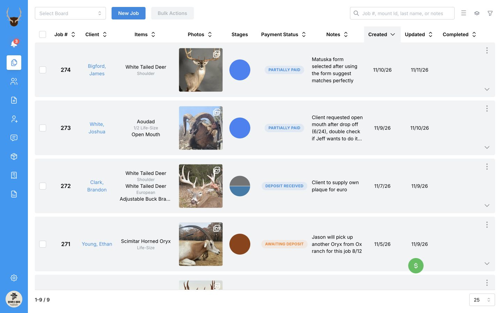
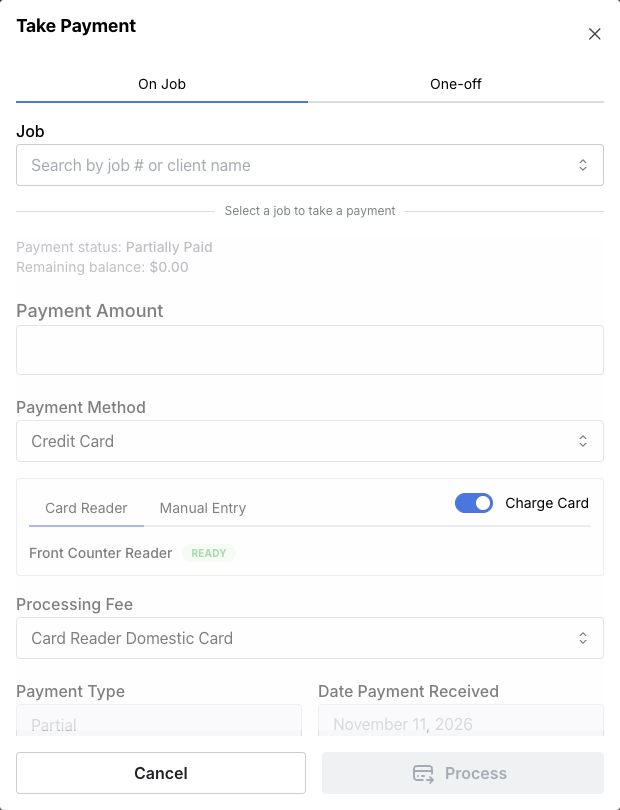

Take job payments wherever you are in MountMonitor, or turn an iPad at the counter into a dedicated point-of-sale station with a connected card reader.

The floating green **$** button keeps [MountMonitor Payments](/payments/overview#mountmonitor-payments) within reach as you move between screens. Use **On Job** to take a job payment or **One-off** for a sale with no job.

## Turn on the POS quick button

1. Open **Settings**.
2. Select **Payments**, then **Card Reader**.
3. Turn on **Show POS quick-charge button**. The green **$** button appears in the app.

  
  <svg viewBox="0 0 1440 900" aria-hidden="true" style={{ position: "absolute", inset: 0, width: "100%", height: "100%", pointerEvents: "none" }}>
    <path d="M 635 230 Q 435 213 363 283" fill="none" stroke="white" strokeWidth="14" strokeLinecap="round" />
    <path d="M 635 230 Q 435 213 363 283" fill="none" stroke="#ef4444" strokeWidth="7" strokeLinecap="round" />
    <path d="M 368 259 L 361 286 L 388 277" fill="none" stroke="white" strokeWidth="14" strokeLinecap="round" strokeLinejoin="round" />
    <path d="M 368 259 L 361 286 L 388 277" fill="none" stroke="#ef4444" strokeWidth="7" strokeLinecap="round" strokeLinejoin="round" />
  </svg>

## Move it where it suits you

Press and hold the green **$** button, drag it to a convenient spot, then release it. You can move it again whenever it gets in the way.

The button stays available when you change screens. MountMonitor remembers its position in the same browser, including after a refresh. Its position may differ on another device or browser.

  
  <svg viewBox="0 0 1440 900" aria-hidden="true" style={{ position: "absolute", inset: 0, width: "100%", height: "100%", pointerEvents: "none" }}>
    <path d="M 1000 605 Q 1130 625 1170 737" fill="none" stroke="white" strokeWidth="14" strokeLinecap="round" />
    <path d="M 1000 605 Q 1130 625 1170 737" fill="none" stroke="#ef4444" strokeWidth="7" strokeLinecap="round" />
    <path d="M 1148 723 L 1174 739 L 1175 710" fill="none" stroke="white" strokeWidth="14" strokeLinecap="round" strokeLinejoin="round" />
    <path d="M 1148 723 L 1174 739 L 1175 710" fill="none" stroke="#ef4444" strokeWidth="7" strokeLinecap="round" strokeLinejoin="round" />
  </svg>

## Open a job payment

1. Select the green **$** button to open **Take Payment**.
2. Select **On Job**.
3. Under **Job**, search by job number or client name, then select the correct job.
4. Check the client, job number, and remaining balance.

  

Only jobs with an outstanding balance are listed; pending jobs are excluded. The faded payment fields become available when you choose a job.

From here, follow [Take a payment](/payments/record-a-payment) to charge a card using your reader or manual entry, pass on processing fees where applicable, or record cash and other payments. The payment is saved against the job you selected.

## Take a payment without a job

Select **One-off** for a sale that has no MountMonitor job, such as a walk-in plaque purchase. See [Take a one-off payment](/payments/take-a-one-off-payment) for the card and cash steps.

## If the button is missing

Check **Settings → Payments → Card Reader → Show POS quick-charge button**. The shortcut requires MountMonitor Payments to be enabled on your account.

Charging cards also requires a connected payment account. To use a reader, [set up your card reader](/payments/set-up-a-card-reader) first. Contact [support](mailto:contact@mountmonitor.com) if the setting is unavailable.
