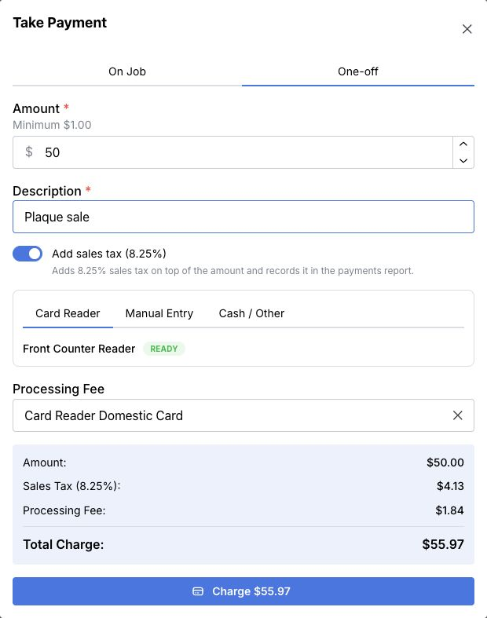
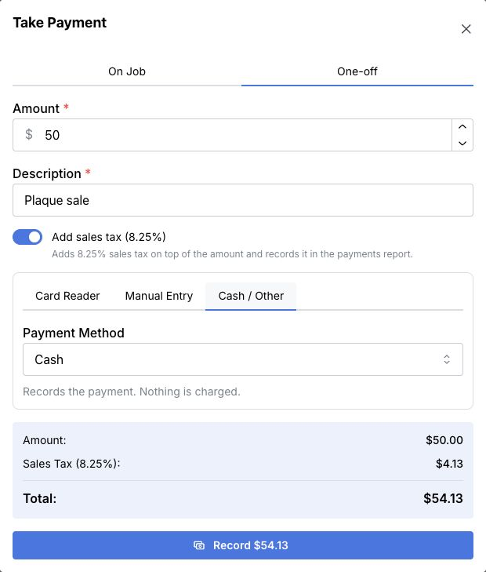

Use a one-off payment for a sale or money received that does not belong to a MountMonitor job—for example, a walk-in plaque sale.

<Note>To pay a deposit or balance on an existing job, use [On Job](/payments/take-a-job-payment-with-pos). A one-off payment does not reduce a MountMonitor job’s balance.</Note>

## Enter the sale details

1. Select the floating green **$** POS quick button, then select **One-off**.
2. Enter the **Amount**.
3. Enter a clear **Description**, such as **Plaque sale**.
4. If a sales-tax switch appears, read its label and check the total. **Add sales tax** adds tax to the entered amount. If your screen says **Amount includes sales tax**, it records the included tax portion without adding to that amount.

The switch uses your account’s configured tax rate and can start turned on. Check it for each payment. The examples below show a sample account’s tax and fee settings; use the settings and totals appropriate to your sale.

## Collect a card payment

1. Select **Card Reader**, then check the selected reader. Alternatively, select **Manual Entry** and enter the card details in the secure payment fields.
2. Review **Processing Fee**, any sales tax, and **Total Charge**. Card payments require an amount of at least 1 before these additions.
3. Check the total with the client, then select **Charge** followed by the displayed amount.
4. For a reader payment, have the client follow the reader’s instructions.
5. Wait for **Payment Successful!** before treating the charge as complete.

  

The button charges the displayed total, including any added tax and processing fee. Do not use it to record a card payment you have already taken elsewhere.

## Check the processing fee

Card payments show a **Processing Fee** choice. Check it after choosing **Card Reader** or **Manual Entry**, because the default fee can change with the card-entry method. Choose a configured fee or clear it if you do not want to add one.

The summary separates **Amount**, any added sales tax, and **Processing Fee**. **Total Charge** is what the card will be charged. Confirm that total with the client before selecting **Charge**.

Selecting **Cash / Other** removes the card-processing fee choice. Its **Total** is the amount you are recording as already received, including any tax added by the sales-tax switch.

## Record cash or another payment already received

1. Enter the amount and description under **One-off**, then check any sales-tax setting.
2. Select **Cash / Other**.
3. Select **Payment Method**, such as **Cash**, **Check**, **Bank Transfer**, **Venmo**, **PayPal**, or **Other**.
4. Check **Total** against the amount received, then select **Record** followed by the displayed amount.
5. Wait for **Payment Recorded**.

  

This records the money received. Nothing is charged through the reader or card-entry fields, and no card-processing fee is added by this option.

## If you use QuickBooks

If **QuickBooks Invoice ID** is shown, you can enter an invoice number to apply the payment to that QuickBooks invoice. Wait for the lookup and check the invoice and remaining balance before proceeding.

If that invoice belongs to a job in MountMonitor, the app directs you to **On Job** instead so both the job and its payment are updated. Linking a separate QuickBooks invoice does not turn a one-off payment into a MountMonitor job payment.

If the payment succeeds but QuickBooks sync fails, check the payment before fixing the accounting record. Do not charge or record it again just to retry the sync.

## Find the payment afterwards

One-off payments appear in the **Payments** report and are identified as **One-off**. They are not attached to a job. See [View transactions and bank payouts](/payments/view-transactions-and-payouts) for card transaction and payout guidance.

## If you need to correct it or give money back

Find the original one-off payment in the **Payments** report first. It will not be in a job’s payment list. Keep track of whether you charged a card through MountMonitor or only recorded money received by another method.

Changing a record does not return money to a card. For a recorded cash or other payment, return the money using the original method and keep the record accurate. If you need help correcting or refunding a one-off payment, contact [support](mailto:contact@mountmonitor.com) with the payment details.

## If the button or payment method is missing

Turn on **Show POS quick-charge button** in **Settings → Payments → Card Reader** if available. The POS shortcut requires MountMonitor Payments to be enabled; charging cards also needs a connected payment account. **Card Reader** requires an available reader.

[Take a payment against a job](/payments/record-a-payment) · [Use POS for a job payment](/payments/take-a-job-payment-with-pos)
