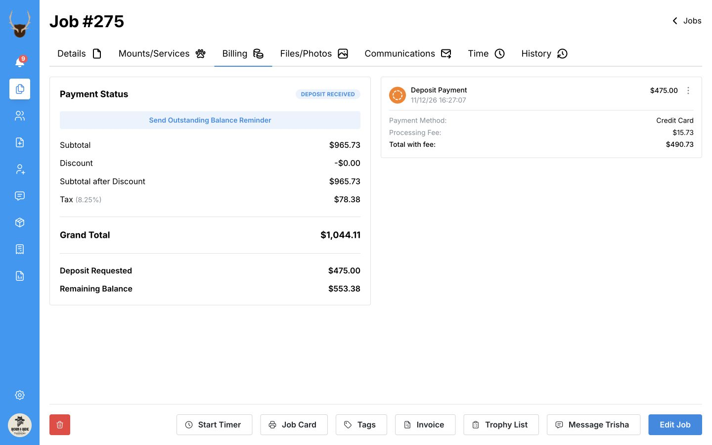

A deposit gets the job started. Part payments let the client pay along the way, and the final payment clears what is left. MountMonitor keeps these payments together on the job so you can see what has been received and what is still owing.

Open a job and select **Billing** to see its totals, requested deposit, remaining balance, and saved payments.

  

## Read the amounts on a job

| Amount | What it means |
| --- | --- |
| **Subtotal** | The mount and service prices before discounts and tax. Added processing fees can also appear in the job's charges. |
| **Grand Total** | The job total after discounts and any applicable tax and fees. |
| **Deposit Requested** | The deposit amounts set on the job's mounts and services, added together. This is a request, not proof of payment. |
| **Remaining Balance** | What is still owing after recorded payments and refunds. |
| **Total with fee** on a payment | The amount received for that payment, including its added fee and any applicable fee tax. |

### An example without added fees

A job totals **1,000** and requests a **500** deposit.

1. Before the client pays, the remaining balance is **1,000**.
2. Take the **500** deposit. The remaining balance becomes **500**.
3. Take a further **200** part payment. The remaining balance becomes **300**.
4. Take the final **300**. The remaining balance becomes **0**.

With **MountMonitor Payments**, charging the card and saving the payment happen in one flow. You can also log cash or other money already received. See [Take a payment](/payments/record-a-payment).

## Understand payment status

| Status | What to check |
| --- | --- |
| **Awaiting Deposit** | A deposit has been requested and is still outstanding. |
| **Unpaid** | No payment is recorded and there is still money owing. |
| **Deposit Received** | A deposit payment has been recorded. There may still be a balance to pay. |
| **Partially Paid** | Money has been received, but the job still has a balance. |
| **Paid in Full** | The job's balance has been paid. |

Read the **Remaining Balance** and individual payments alongside the status, especially after a refund or price change. A job's payment status is separate from its mount stages and its active or closed status.

## Set the deposit you request

Set deposits on mounts and services when creating the job. Matching [price-list entries](/shop-setup/price-list) can fill them in for you. The deposit does not become money received until you take or log a payment.

When the amount taken differs from the requested deposit, MountMonitor can classify it as a **Partial** payment. Check the amount and any message shown rather than changing the status to make it look paid.

Payment plans use their own initial payment and instalment schedule. Use [Create a payment plan](/payments/create-a-payment-plan) for that route instead of adding ordinary deposit amounts.

## Fees, price changes, and refunds

- **Processing fees:** A passed-on fee adds a charge to the job and is included in the payment total. Check the payment summary and fee settings when comparing amounts.
- **Price changes:** Adding work or changing prices can change what is still owed. Review the updated balance before taking the final payment.
- **Refunds:** Returning money reduces the amount held against the job. It does not cancel the work or reduce its price for you. A linked processing-fee line is also adjusted. See [Refund a payment](/payments/refund-a-payment).

## If the balance does not look right

Check each payment's date, amount, fees, and refunds. Look for a payment logged twice or money received outside MountMonitor that has not been recorded. Use [Correct a payment record](/payments/correct-a-payment-record) for an eligible recording mistake.

If a card may have been charged but no payment appears on the job, check [transactions](/payments/view-transactions-and-payouts) before charging again. [Contact support](mailto:contact@mountmonitor.com) if you cannot confirm the result.
