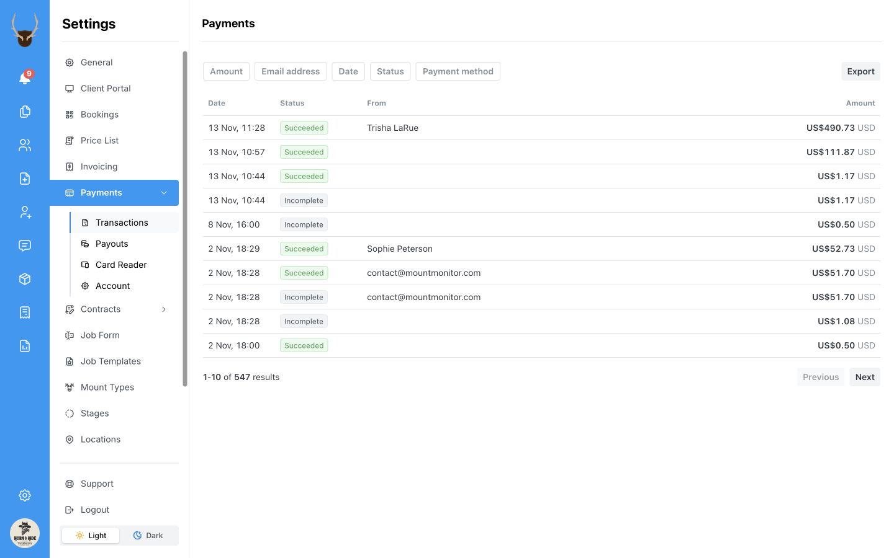
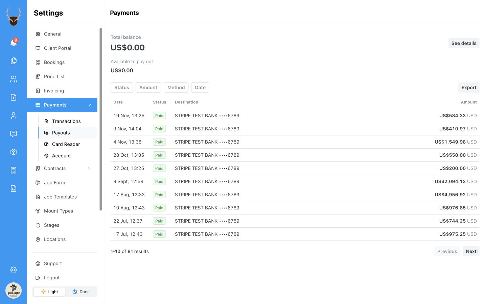

See the card payments you have collected through **MountMonitor Payments**, then follow the money as it is paid into your bank account.

A **transaction** is a client's payment. A **payout** is money sent from your payment account to your bank, and can include several transactions after fees and other adjustments.

## Find a payment

1. Open **Settings → Payments → Transactions**.
2. Use **Date**, **Amount**, **Email address**, **Status**, or **Payment method** to narrow the list.
3. Find the payment by its date, amount, and payer. Select the row to open its details.
4. Check its status before deciding whether another payment attempt is needed.

  

**Succeeded** means the payment succeeded in the payment system. Check the job's **Billing** tab as well to confirm it has been recorded against the job. An **Incomplete** entry does not show a completed payment; use its details to understand what happened.

This screen covers payments processed through MountMonitor Payments. Cash and other payments you only logged belong in the job's **Billing** records and the [payments report](/reports/payment-report).

## Find a payout to your bank

1. Open **Settings → Payments → Payouts**.
2. Review **Total balance** and **Available to pay out**.
3. Find the payout using its date, amount, or status. Check **Destination** to identify the bank account.
4. Select the payout to see its **Timeline**, destination, amount, and transaction information.

  

| Item | What it tells you |
| --- | --- |
| **Total balance** | Money currently shown in your payment account. It is separate from your bank balance. |
| **Available to pay out** | The portion currently available for a payout. |
| Payout status and timeline | Whether the transfer is still progressing or has completed. |
| Destination | The bank account the payout was sent to. |
| Summary and transactions | The payments, fees, and adjustments behind that payout. |

A client payment does not have to arrive in your bank as a separate deposit. Several payments can be grouped into one payout, and processing fees, refunds, and adjustments can change the amount.

Use **Export** on the transaction or payout list when you need a file of the records shown.

## Check your payment account details

Open **Settings → Payments → Account** to review your payment-account information and any details you need to complete. Follow the options shown there for bank or business information. Changes can require verification.

If Transactions or Payouts is missing, check that [MountMonitor Payments setup](/payments/set-up-payments) is complete and enabled. Ask the person managing the account or contact support if access is unclear.

## If a payout has not arrived

Open that payout and read its status, timeline, destination, and any instructions shown. Follow the expected date and guidance for that particular payout rather than assuming every payout takes the same time.

If it is marked paid but is not visible at your bank, follow the bank-processing guidance in the payout details. [Contact support](mailto:contact@mountmonitor.com) with the payout date, amount, and status if you still need help.

## Related guides

- [Take a payment](/payments/record-a-payment)
- [Refund a payment](/payments/refund-a-payment)
- [Fix a payment problem](/payments/troubleshoot-a-payment)
