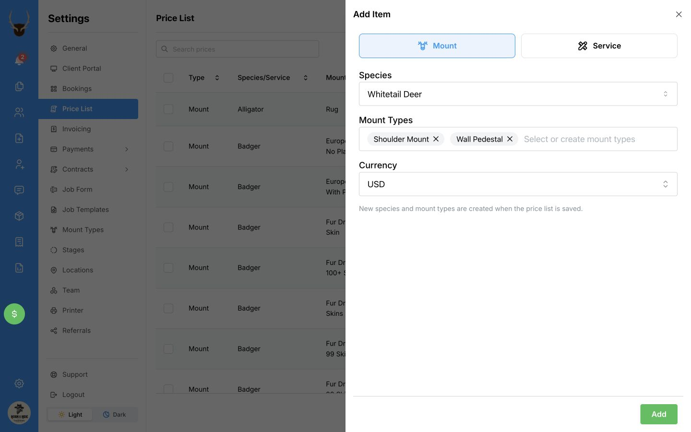
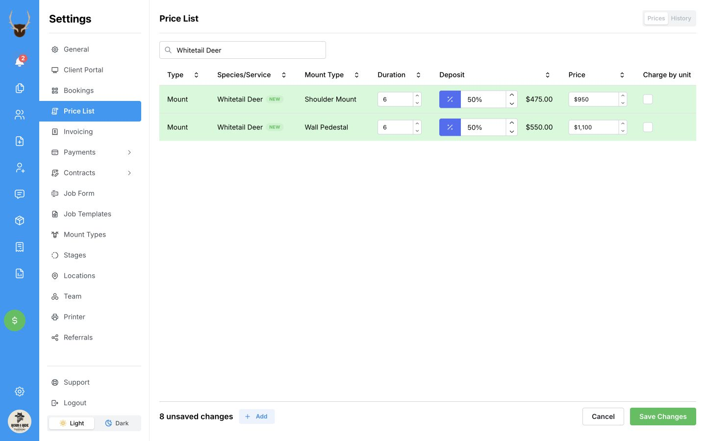

Set a price for a species and mount type, such as a Whitetail Deer Shoulder Mount. You can add several mount types for the same species at once, with an optional deposit and estimated completion time for each.

## Choose the species and mount types

1. In **Settings → Price List**, select **Add Price**.
2. In **Add Item**, select **Mount**.
3. Under **Species**, choose the species you want to price. If it is missing, type its name and select **+ Create** followed by the name.
4. Under **Mount Types**, choose one or more mount types. For example, you could choose **Shoulder Mount** and **Wall Pedestal** for **Whitetail Deer**. To add a new mount type, type its name and press **Enter**.
5. Check **Currency**, then select **Add**.

  

    
    <svg viewBox="0 0 1360 900" aria-hidden="true" style={{ position: "absolute", inset: 0, width: "100%", height: "100%", pointerEvents: "none" }}>
      <path d="M 1090 660 Q 1220 675 1290 825" fill="none" stroke="white" strokeWidth="14" strokeLinecap="round" />
      <path d="M 1090 660 Q 1220 675 1290 825" fill="none" stroke="#ef4444" strokeWidth="7" strokeLinecap="round" />
      <path d="M 1265 808 L 1294 831 L 1299 795" fill="none" stroke="white" strokeWidth="14" strokeLinecap="round" strokeLinejoin="round" />
      <path d="M 1265 808 L 1294 831 L 1299 795" fill="none" stroke="#ef4444" strokeWidth="7" strokeLinecap="round" strokeLinejoin="round" />
    </svg>
  

Each mount type appears as a separate new row in your price list. These rows are not saved yet.

<Note>When you select **Save Changes**, any new species or mount types you entered are also added to your shop’s choices. New mount types appear in **Settings → Mount Types**. This does not create a mount on a client’s job.</Note>

## Enter the amounts and save

1. In each new row, enter the full mount price under **Price**.
2. If you require a deposit, enter it under **Deposit**. Use the button beside the amount to switch between a percentage and a fixed amount. For example, a **50%** deposit on a **950** mount is **475**. Leave the deposit blank if you do not require one.
3. If you want an estimated completion time, enter the number of months under **Duration**. For example, enter **6** for six months. You can leave this blank.

  

    
  

4. Check the amounts, then select **Save Changes** at the bottom of the page.

  

    
    <svg viewBox="0 0 1360 900" aria-hidden="true" style={{ position: "absolute", inset: 0, width: "100%", height: "100%", pointerEvents: "none" }}>
      <path d="M 1090 660 Q 1220 675 1290 825" fill="none" stroke="white" strokeWidth="14" strokeLinecap="round" />
      <path d="M 1090 660 Q 1220 675 1290 825" fill="none" stroke="#ef4444" strokeWidth="7" strokeLinecap="round" />
      <path d="M 1265 808 L 1294 831 L 1299 795" fill="none" stroke="white" strokeWidth="14" strokeLinecap="round" strokeLinejoin="round" />
      <path d="M 1265 808 L 1294 831 L 1299 795" fill="none" stroke="#ef4444" strokeWidth="7" strokeLinecap="round" strokeLinejoin="round" />
    </svg>
  

Your saved prices are available when you choose the matching species and mount type on a new job in that currency. Setting a deposit here does not collect a payment or mark it as paid.

<Tip>To collect half of a tax-inclusive total when your prices exclude tax, see [Include tax in your deposit](/price-list/change-prices-and-deposits#include-tax-in-your-deposit).</Tip>

## Charge by unit

If you charge by area or length, turn on **Charge by unit** in the mount’s price row and enter the rate for one unit under **Price**. The unit follows your shop’s measurement settings. Leave it off for a single fixed price. Check the measurements and resulting total when you add the mount to a job.

## If you are starting with no choices

You do not need an existing price, species, or mount type. Type the species name and select **+ Create**. Type each mount type and press **Enter**. The new choices are saved together with the prices when you select **Save Changes**.

## If a mount type is already priced

The form lists existing prices under **Already priced**. To change one, close the form and follow [Change prices and deposits](/price-list/change-prices-and-deposits).

## On a phone

Select **Add Price**, then **Mount**. Choose or create the species and choose the mount type. Enter the currency, price, and any deposit or completion time shown, then select **Set Price**. Repeat for another mount type.

## What happens next

The price fills in when you choose the matching species and mount type on a new job in that currency. An optional duration supplies an estimated completion time; you can review the date on the job. Adding a price does not create a client job or send a client a message.

[Add a service price](/price-list/add-a-service-price) · [Change prices and deposits](/price-list/change-prices-and-deposits)
