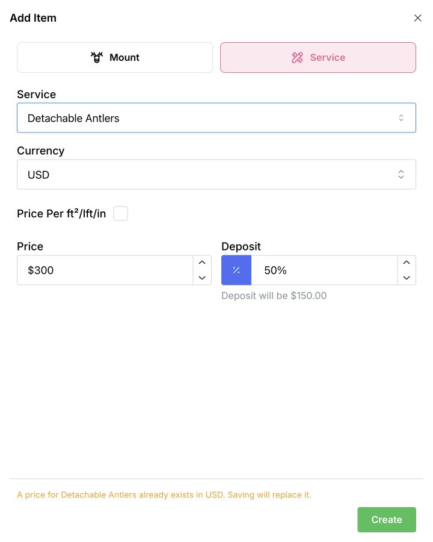

Use a service price for extras or other work you want to charge for on a job. You can add your first service even when the price list is empty.

## Add the service

1. In **Settings → Price List**, select **Add Price**.
2. In **Add Item**, select **Service**.
3. Under **Service**, choose an existing service, or type a new name and select **+ Create** followed by the name.
4. Check **Currency**, then enter the amount under **Price**.
5. If you require a deposit, enter it under **Deposit**. Use the button beside the amount to choose a percentage or a fixed amount. Leave it blank if you do not require a deposit.
6. Review the amounts, then select **Create** at the bottom of the form.

<Frame>
  

    
    <svg viewBox="0 0 720 900" aria-hidden="true" style={{ position: "absolute", inset: 0, width: "100%", height: "100%", pointerEvents: "none" }}>
      <path d="M 490 650 Q 615 690 650 827" fill="none" stroke="white" strokeWidth="12" strokeLinecap="round" strokeLinejoin="round" />
      <path d="M 490 650 Q 615 690 650 827" fill="none" stroke="#dc2626" strokeWidth="6" strokeLinecap="round" strokeLinejoin="round" />
      <path d="M 629 810 L 653 834 L 659 801" fill="none" stroke="white" strokeWidth="12" strokeLinecap="round" strokeLinejoin="round" />
      <path d="M 629 810 L 653 834 L 659 801" fill="none" stroke="#dc2626" strokeWidth="6" strokeLinecap="round" strokeLinejoin="round" />
    </svg>
  

</Frame>

This screenshot uses an existing example service, so it shows a replacement notice. You will not see that notice when adding a service that has no price in that currency.

The saved price is available when you add that service to a job in the same currency. Creating a service price does not collect money or create a client job.

<Note>Creating a new service name adds it to your service choices immediately. Closing the form before selecting **Create** leaves the name available, but does not save a price.</Note>

## Charge by unit

If you charge by area or length, turn on **Price Per** and enter the rate for one unit. The unit label follows your shop’s measurement settings. Leave it off for a single fixed price. Check the measurements and resulting total when you add the service to a job.

## If the price already exists

The form warns you when that service already has a price in the selected currency. Selecting **Create** replaces that price. To review the existing amount first, close the form and use [Change prices and deposits](/price-list/change-prices-and-deposits).

[Include tax in your deposit](/price-list/change-prices-and-deposits#include-tax-in-your-deposit) · [Add a mount price](/price-list/add-a-mount-price)
