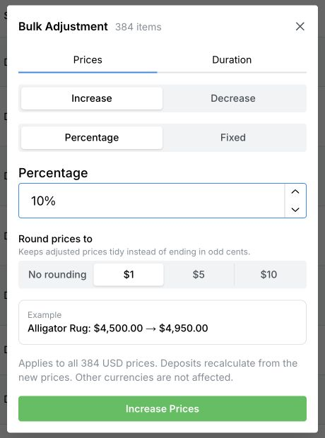

Use **Bulk Adjustment** when you want the same change applied to several saved prices. For one item, use [Change prices and deposits](/price-list/change-prices-and-deposits).

These steps use the laptop or desktop layout.

## Choose which prices to change

1. Open **Settings → Price List** and select the currency, if currency tabs are shown.
2. To change only some prices, select their checkboxes. You can search first, then use the checkbox in the table heading to select all visible prices.
3. Select **Bulk Adjust Selected**. To change every price in the current currency instead, clear any selection, open the three-dot menu above the list, and select **Bulk Adjustment**.

<Warning>Searching alone does not limit a bulk adjustment. With no rows selected, it applies to every price in the current currency. Selections can remain checked when you change the search; clear the search to review the full selection, or select **Clear** and start again.</Warning>

## Increase or decrease the prices

1. In **Bulk Adjustment**, keep **Prices** selected.
2. Choose **Increase** or **Decrease**.
3. Choose **Percentage** or **Fixed**, then enter the percentage or amount. For example, enter **10** for a ten-percent increase.
4. For a percentage change, choose **Round prices to**. Select **No rounding** to avoid rounding to whole currency amounts, or choose one of the displayed increments.
5. Check the item count, currency, and before-and-after example.
6. Select **Increase Prices** or **Decrease Prices** to apply the change.

<Frame>
  
</Frame>

The screenshot shows the whole-list option. Your item count will depend on your saved prices and selection. Selecting the final button saves the adjustment immediately.

Percentage deposits recalculate from the new prices; fixed deposits remain fixed. Other currencies are unaffected. Existing saved jobs are not automatically repriced, but matching job templates can be updated. See [Where changes apply](/price-list/change-prices-and-deposits#where-changes-apply).

## Set completion times together

1. Choose the prices as described above and open **Bulk Adjustment**.
2. Select **Duration**.
3. Enter the number of **Months**. Enter **0** to clear the usual completion time.
4. Check the mount count, then select **Set Durations**.

This sets the same duration on the selected mounts, or all mounts in the current currency when nothing is selected. Services are skipped. Existing jobs keep their completion dates.

## Check or correct an adjustment

Use [View price history](/price-list/view-price-history) to see the recorded changes. History does not have an undo button. If you need a correction, use the recorded previous amounts and [edit the prices](/price-list/change-prices-and-deposits); applying the opposite percentage may not restore the original amounts.
