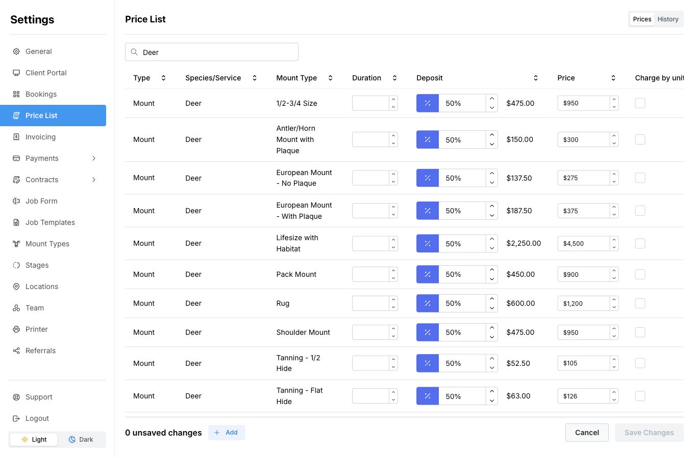

Use these steps after you have added prices. If your list is empty, start with [Add a mount price](/price-list/add-a-mount-price) or [Add a service price](/price-list/add-a-service-price).

## Edit your prices

1. Open **Settings → Price List**. If currency tabs are shown, select the currency you want to change.
2. Use **Search prices** to find a species, mount type, or service.
3. Select **Edit Prices** at the bottom of the page.
4. Change the **Price**, **Deposit**, or mount **Duration** you need. Duration is in months. For a percentage deposit, use the percentage button beside the amount; switch it to a currency amount for a fixed deposit.
5. Review your changes, then select **Save Changes** at the bottom right.

<Frame>
  
</Frame>

Use **Charge by unit** only when the price is a rate per measurement rather than one fixed amount. Review the measurement and total on the job.

<Tip>To leave without saving, select **Cancel**, then **Discard Changes** if asked.</Tip>

## Choose a deposit

A percentage deposit changes with the price. A fixed deposit stays at the amount you enter. For example, a **50%** deposit on **950** is **475**. Leave the deposit blank if you do not require one.

A percentage cannot exceed **100%**. A fixed deposit must be less than the price. The preview beside a percentage deposit shows the calculated amount.

Setting a deposit here does not take a payment or mark it as paid. To record money already received, use [Record a payment](/payments/record-a-payment).

## Include tax in your deposit

The deposit percentage is calculated from the **Price** you enter. If your listed price excludes tax and you want to collect half of the total including tax, add half your tax rate to **50%**.

For example, with a **6.5%** tax rate, enter **53.25%** as the deposit: **50 + (6.5 ÷ 2)**. On a **1,000** price, the deposit is **532.50**—half of the **1,065** total including tax.

If your listed price already includes tax, use **50%**. This example assumes the full price is taxable at that rate; changing the deposit percentage does not set the job’s tax rate.

## Where changes apply

Mount prices match the **species, mount type, and currency**. Service prices match the **service and currency**. If you use several currencies, set each price separately; MountMonitor does not convert them using an exchange rate.

Saved jobs keep their existing amounts. However, changing the species, mount type, or service while editing a job can fill in its current price. Check the job’s amounts before saving.

Price and deposit changes can update matching saved job templates. Review any templates you use after a change, especially if the app reports a problem updating them. Changing only a duration does not reprice a template or move the completion date on an existing job.

Your current prices are also used by booking options that draw from your price list. Other currencies keep their own prices.

## On a phone

Find the item, open its three-dot menu, and select **Edit**. Change its price or deposit, then select **Save Price**. The item’s name, mount type, and currency are fixed in this form.

## If you cannot save

Check any highlighted field and its message. Every new price row needs a price. Check that your deposit follows the limits above.

[Adjust several prices at once](/price-list/adjust-several-prices) · [View price history](/price-list/view-price-history)
