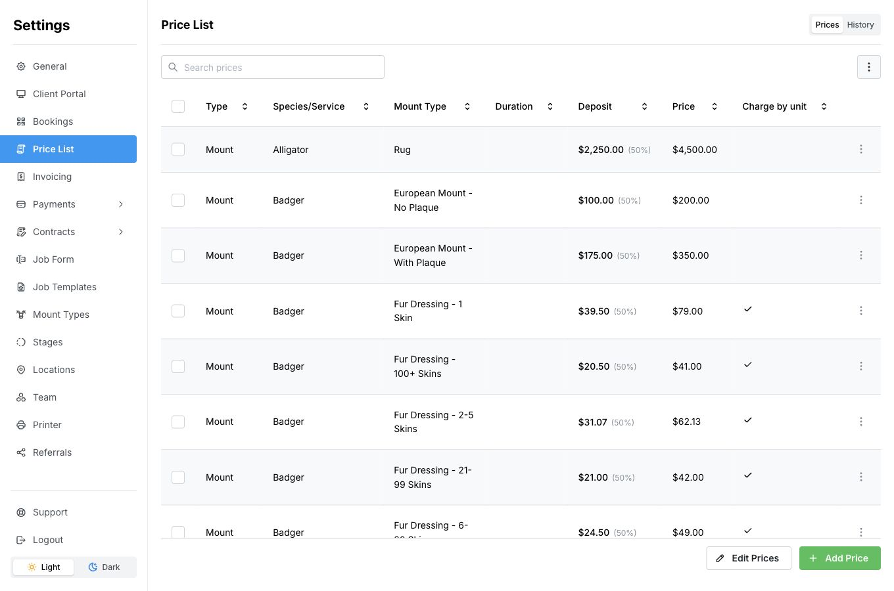

Export your saved prices as a CSV file, which you can open in a spreadsheet program such as Excel.

Use the laptop or desktop layout for these steps.

1. Open **Settings → Price List** and select **Prices** if you are viewing history.
2. Save or cancel any edits you have open.
3. Open the three-dot menu above the list, beside the search field.
4. Select **Export CSV**.
5. Open the downloaded file from your browser’s downloads.

<Frame>
  

    
    <svg viewBox="0 0 1360 900" aria-hidden="true" style={{ position: "absolute", inset: 0, width: "100%", height: "100%", pointerEvents: "none" }}>
      <path d="M 1040 340 Q 1180 330 1235 218" fill="none" stroke="white" strokeWidth="12" strokeLinecap="round" strokeLinejoin="round" />
      <path d="M 1040 340 Q 1180 330 1235 218" fill="none" stroke="#dc2626" strokeWidth="6" strokeLinecap="round" strokeLinejoin="round" />
      <path d="M 1211 233 L 1239 212 L 1243 246" fill="none" stroke="white" strokeWidth="12" strokeLinecap="round" strokeLinejoin="round" />
      <path d="M 1211 233 L 1239 212 L 1243 246" fill="none" stroke="#dc2626" strokeWidth="6" strokeLinecap="round" strokeLinejoin="round" />
    </svg>
  

</Frame>

The file contains all saved prices in all currencies, including item names, mount types, prices, deposits, and durations where set. Searching or selecting rows does not limit the export.

Changing the downloaded file does not update MountMonitor. To change the prices in your shop, use [Change prices and deposits](/price-list/change-prices-and-deposits).

## If no file downloads

Check that your price list contains saved prices and that you have finished editing. Check your browser’s downloads before trying again. If your list is empty, [add your first price](/price-list/add-a-mount-price) first.
