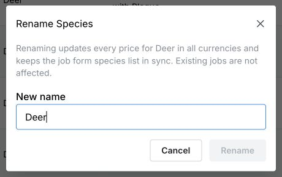
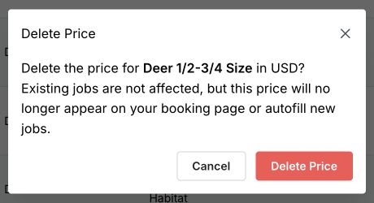

Open **Settings → Price List** and use **Search prices** to find the item. These actions are in the three-dot menu at the end of its row, or on its card on a phone.

## Rename a species or service

1. Open the item’s three-dot menu and select **Rename**.
2. In **Rename Species** or **Rename Service**, enter the **New name**.
3. Review the name, then select **Rename**.

<Frame>
  
</Frame>

For a species, this renames every price under that species, across all its mount types and currencies. For a service, it renames that service’s prices across currencies. It also updates the species or service choice used in job forms. Existing jobs keep their recorded names.

<Warning>Check whether the new name already has prices before renaming. If both names have a price for the same mount type and currency, the existing destination price can be replaced.</Warning>

This menu renames the species or service, not the mount type. Manage mount-type names in **Settings → Mount Types**. Review saved job templates separately after renaming an item.

## Delete a price

1. Find the correct item and currency, then open the row’s three-dot menu.
2. Select **Delete**.
3. Read the **Delete Price** message. By default, it removes that price in the current currency. If an option to delete it in all currencies appears, select it only if you want those prices removed too.
4. If this is the last price using that species or service name, you may also be offered the option to remove the name from your species or services list. Leave it unchecked if you want the choice available for future jobs.
5. Select **Delete Price** to confirm, or **Cancel** to keep it.

<Frame>
  
</Frame>

Existing jobs are not affected. The deleted price stops filling in new jobs and is removed from booking options that use it. Deleting a price does not delete its mount type. Review saved job templates separately if you no longer offer the item.

To offer it again later, [add the mount price](/price-list/add-a-mount-price) or [service price](/price-list/add-a-service-price) again.
