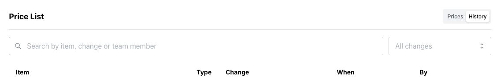

Price history helps you check when an amount changed, who changed it, and the previous value.

1. Open **Settings → Price List**.
2. Select **History** at the top right.
3. Use **Search by item, change or team member** to narrow the list. Use **All changes** to filter by the kind of change.
4. Read **Item**, **Type**, **Change**, **When**, and **By**. Where a row shows several changes or an expansion arrow, select it to see the details.

<Frame>
  
</Frame>

The list includes additions, edits, bulk adjustments, deletions, renames, and imports. It loads the latest 100 history events. A new shop may have no history until prices have been saved or changed. Unsaved edits do not appear.

## Correct a mistake

History is a record, not an undo tool. Note the previous amount, return to **Prices**, and use [Change prices and deposits](/price-list/change-prices-and-deposits) to correct it. To restore a removed price, add it again.

Seeing an **Imported** entry records a past import; it does not provide an import button in this screen.
