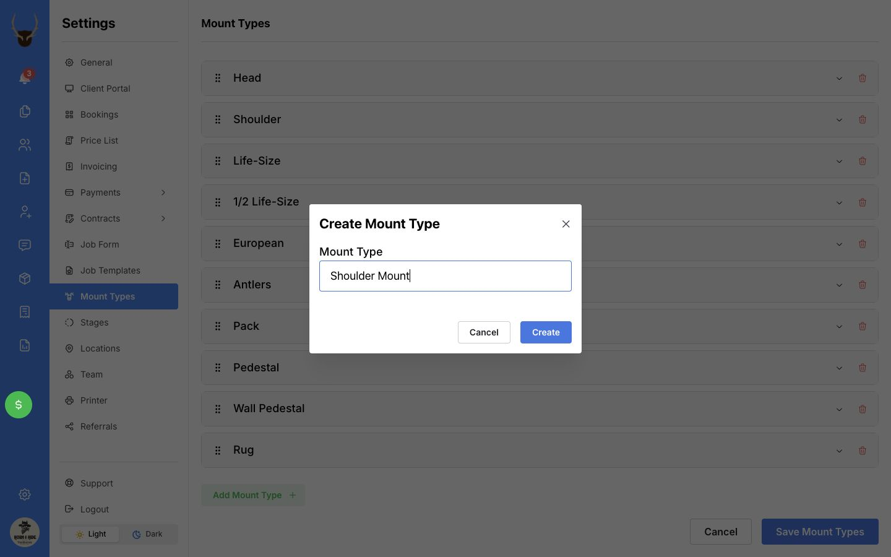
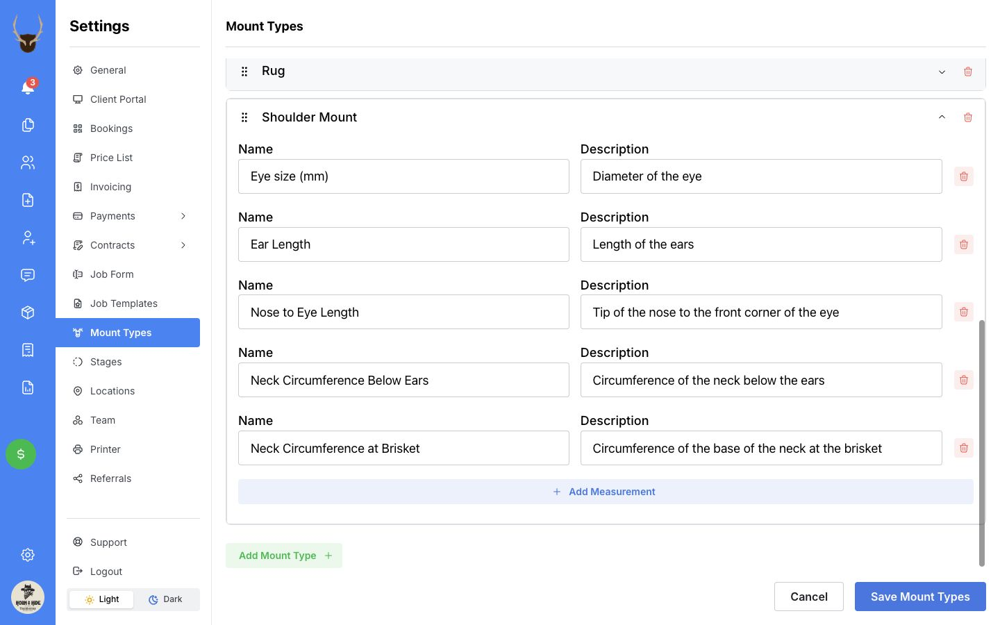

Mount types are the kinds of mounts your shop offers, such as **Shoulder Mount**, **Life-Size**, or **European**. Each type can have its own measurement fields. When you choose that mount type on a job, those fields are available for you to fill in.

For example, you could record nose-to-eye and neck measurements for a shoulder mount, and body length and girth for a life-size mount. You can choose your own mount-type names and measurement fields to suit your shop. Keep the supplied fields, change them, or add your own.

## Add a mount type

1. Open **Settings**, then select **Mount Types**.
2. Select **Edit Mount Types** at the bottom of the page.
3. Select **Add Mount Type**. You may need to scroll to the bottom of the list.
4. Enter the **Mount Type** name, such as **Shoulder Mount**, then select **Create**.
5. Select the new mount type to open its measurement fields. Review any fields supplied automatically, then follow the measurement steps below.
6. Select **Save Mount Types** when you have finished.

  

    
  

**Create** adds the type to your unsaved list. **Save Mount Types** saves it to your account. To abandon your changes before saving, select **Cancel** at the bottom of the settings page.

<Tip>You can name mount types whatever makes sense to your team. For example, use **Shoulder Mount**, **Wall Pedestal**, or a more specific name you already use in your shop. You can price the same mount type differently for each species in your [price list](/price-list/add-a-mount-price).</Tip>

## Set up measurement fields

These settings define the fields you want to use. You enter each animal’s actual measurements on its job.

1. In **Settings → Mount Types**, select **Edit Mount Types**.
2. Select the mount type you want to work on to open it.
3. To add a field, select **Add Measurement** inside that mount type.
4. Enter a short, distinct **Name**, such as **Nose to Eye** or **Neck at Ears**.
5. In **Description**, explain where or how your shop takes that measurement. This text appears beneath the field when entering measurements on a job.
6. Finish that field before adding the next one. Check that each field has its own name.
7. Review the fields, then select **Save Mount Types** at the bottom right.

  

    
    <svg viewBox="0 0 1360 900" aria-hidden="true" style={{ position: "absolute", inset: 0, width: "100%", height: "100%", pointerEvents: "none" }}>
      <path d="M 1070 680 Q 1180 700 1244 826" fill="none" stroke="white" strokeWidth="14" strokeLinecap="round" />
      <path d="M 1070 680 Q 1180 700 1244 826" fill="none" stroke="#ef4444" strokeWidth="7" strokeLinecap="round" />
      <path d="M 1219 810 L 1248 832 L 1254 797" fill="none" stroke="white" strokeWidth="14" strokeLinecap="round" strokeLinejoin="round" />
      <path d="M 1219 810 L 1248 832 L 1254 797" fill="none" stroke="#ef4444" strokeWidth="7" strokeLinecap="round" strokeLinejoin="round" />
    </svg>
  

The screenshot shows example fields supplied for a shoulder mount. You can edit them to match your workflow. Some mount types may have no measurement fields until you add them.

### Choose useful names and descriptions

Use names your team understands and descriptions that remove ambiguity. You can use descriptive names such as **Nose to Eye**, letters such as **A**, **B**, **C**, and **D**, or a combination such as **A — Nose to Eye**. Use a different name for each field and describe the measurement points required by the forms or suppliers you use.

| Example field name | What to put in its description |
| --- | --- |
| **Nose to Eye** | The exact start and end points your shop uses. |
| **Neck at Ears** | Where around the neck this measurement is taken. |
| **Body Length** | The start and end points and the position used. |
| **Eye size (mm)** | What the eye-size number refers to. |

Measurement fields accept numbers. Use the **Description** to explain the field; record general instructions or other text in the mount’s notes.

### Inches, centimetres, and millimetres

Job measurement fields use your **Measurement System** in **Settings → General**: inches for Imperial or centimetres for Metric. Check the unit displayed beside the value when entering measurements.

For a field that should always use millimetres, include **(mm)** in its name—for example, **Eye size (mm)**. That field displays millimetres regardless of your measurement-system setting.

<Tip>Set up measurement names before you start using them on jobs. If a description needs clarification later, edit the **Description** while keeping the **Name** the same.</Tip>

## Enter measurements on a job

1. When creating or editing a job, choose the mount’s **Mount Type**.
2. Turn on **Measurements** for that mount if it is not already selected.
3. Enter the values in the fields you set up. Check the units beside them.
4. Save the job when you have finished your changes.

If recorded measurements are collapsed, select **Expand measurements** to show the fields. If the chosen mount type has no measurement fields, the **Measurements** option will not appear.

## Use your measurements to suggest forms

If you use lettered measurements when ordering forms, you can connect your measurement fields to the letters in **Suggest form**. Your fields can keep the names you chose; select which one belongs to each letter.

1. On a job, choose the mount’s **Mount Type** and enter its measurements.
2. In that mount’s **Materials** section, select **Suggest form**.
3. Check the **A**, **B**, and **C** choices at the top of the window. For each letter, select the field containing the corresponding measurement. MountMonitor may fill these choices in for you; check that they match the form you need.
4. Review the suggested forms and compare their measurements with the mount’s recorded values.

For a shoulder mount, the choices would typically be:

| Form measurement | Your matching field might be called |
| --- | --- |
| **A — Eye to nose** | **Nose to Eye**, **A**, or **A — Nose to Eye** |
| **B — Neck** | **Neck Below Ears**, **B**, or **B — Neck** |
| **C — Neck at brisket** | **Neck at Brisket**, **C**, or **C — Brisket** |

Check the supplier’s measurement guide: a letter can refer to a different measurement on a different kind of form. For example, **C** is neck at the brisket for shoulder-type suggestions and girth/chest for other types.

The tool needs a recorded value connected to **A** to suggest forms. It compares the selected measurements with forms in your available partnered-supplier catalogs, along with the mount’s species and pose details. Check the suggested sizes before choosing a form.

<Note>Form suggestions currently use **A**, **B**, and **C**. You can record **D** and other measurements for your own work, but they are not used to match suggestions.</Note>

If **Suggest form** is missing, check that the mount has a mount type and that you have a partnered supplier with a synced catalog available.

## Put mount types in a useful order

1. In **Settings → Mount Types**, select **Edit Mount Types**.
2. Drag the dotted handle on the left of a mount type to move it up or down.
3. Select **Save Mount Types**.

This is the order of mount types in the job form. Put the ones you use most often near the top.

## Change or remove fields already in use

You can edit a field’s **Name** or **Description**, or select the trash icon beside a measurement to remove it. Select **Save Mount Types** to save the changes.

<Warning>Renaming or removing a measurement field does not move its existing values into another field. When you edit an existing job, values whose field names no longer match the mount type can be removed from the job form and lost when you save it. Check affected jobs and note any values you need before changing fields already in use.</Warning>

Adding a new field makes it available on jobs using that type; you still need to enter a value for each mount. Changing the description keeps the field name, which is how recorded measurements are matched.

## Remove a mount type

1. In **Settings → Mount Types**, select **Edit Mount Types**.
2. Select the trash icon at the right of the mount type you want to remove. This is separate from the trash icons beside individual measurements.
3. Review the remaining list, then select **Save Mount Types**. Select **Cancel** instead if you removed the wrong type.

Existing jobs keep the removed mount type and their saved measurement values, but its measurement fields are no longer available to edit. Removing a mount type here does not remove its saved prices; review your [price list](/price-list/rename-or-remove-an-item) and job templates separately if you no longer offer it.

## If something looks different

- **No Edit Mount Types button:** You need permission to update settings. Ask the person who manages your team’s permissions.
- **A name already exists:** Use the existing mount type or choose a different name.
- **No measurements on a job:** Check that you selected the intended mount type, that it has saved measurement fields, and that **Measurements** is turned on.
- **Changes did not save:** Look for the success message after selecting **Save Mount Types**. If an error appears, try saving again; contact [support](mailto:contact@mountmonitor.com) if it continues.

## Related guides

- [Add a mount price](/price-list/add-a-mount-price)
- [Add a mount to a job](/mounts-and-services/add-a-mount)
- [Create and manage job templates](/shop-setup/job-templates)
