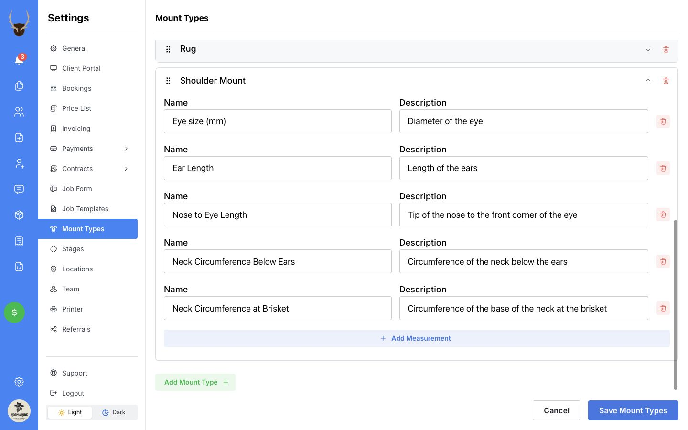
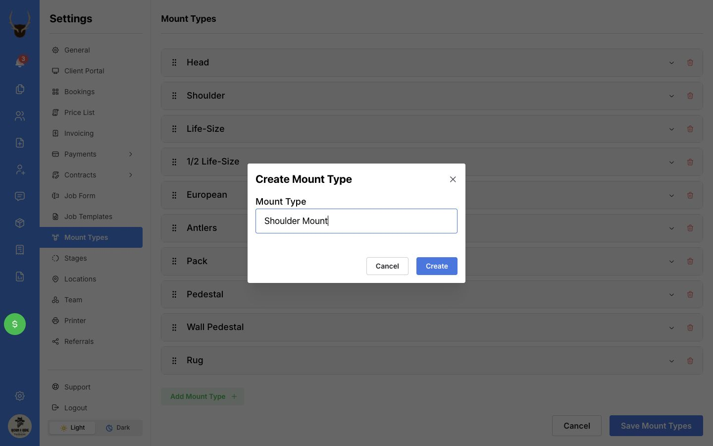

Mount types describe the work your shop offers, such as Shoulder Mount, Lifesize, Rug, or European Mount. You can use whatever names make sense to your team and choose which measurements to record for each type.

To record animal measurements, [add measurement fields](#add-measurement-fields) to the mount type in Settings, then enter the animal's measurements on its job. For example, a shoulder mount might have nose-to-eye and neck measurements, while a lifesize mount might also need body length and girth.

## Add measurement fields

You can add fields to mount types you already have. You do not need to create the mount type again.

1. Open **Settings**, then select **Mount Types**.
2. Select **Edit Mount Types** at the bottom of the page.
3. Select a mount type, such as **Shoulder Mount**, to open it.
4. Select **Add Measurement**.
5. Enter a **Name**, such as **Nose to Eye**. You can also add a **Description** to explain where or how to take the measurement. The description appears as help text on the job.
6. Repeat for the other measurements you want to record. Give each field a different name.
7. Select **Save Mount Types** at the bottom of the page.

Each mount type has its own fields. Adding a neck measurement to **Shoulder Mount** does not add it to **Lifesize** or **Wall Pedestal**. Repeat these steps for each type you measure.

  
  <svg viewBox="0 0 1440 900" aria-hidden="true" style={{ position: "absolute", inset: 0, width: "100%", height: "100%", pointerEvents: "none" }}>
    <path d="M 1160 785 L 1224 834" fill="none" stroke="white" strokeWidth="7" strokeLinecap="round" strokeLinejoin="round" />
    <path d="M 1160 785 L 1224 834" fill="none" stroke="#ef4444" strokeWidth="3.5" strokeLinecap="round" strokeLinejoin="round" />
    <path d="M 1209 832 L 1224 834 L 1218 820" fill="none" stroke="white" strokeWidth="7" strokeLinecap="round" strokeLinejoin="round" />
    <path d="M 1209 832 L 1224 834 L 1218 820" fill="none" stroke="#ef4444" strokeWidth="3.5" strokeLinecap="round" strokeLinejoin="round" />
  </svg>

The screenshot shows example fields. If your mount type says **No measurements.**, use **Add Measurement** to add the fields your shop needs. If it already has fields, you can keep them, change them, or add more.

### Name measurements to suit your shop

Use descriptive names such as **Nose to Eye** and **Neck Below Ears**, letters such as **A**, **B**, **C**, and **D**, or a combination such as **A: Nose to Eye**. Use the description to explain the measurement points so everyone in the shop measures the same way.

<Tip>You can match your field names to the letters on the forms you order. Check your supplier's measurement guide, since the same letter can mean different things on different forms.</Tip>

Measurement fields accept numbers. Put the animal's values on its job, and use the mount's notes for written instructions.

### Choose the units

Your **Measurement System** in **Settings → General** controls the units: inches for Imperial or centimetres for Metric. Check the unit beside each field when entering a value.

For a measurement that should always use millimetres, include **(mm)** in its name, such as **Eye size (mm)**. That field uses millimetres regardless of your measurement-system setting.

## Enter measurements on a job

1. Open the job and select **Edit Job**, or start a new job.
2. Find the mount and choose its **Mount Type**.
3. Select the **Measurements** checkbox for that mount.
4. Enter the values in the fields you set up, checking the units beside them.
5. Save the job.

If measurements are already recorded and collapsed, select the arrow beside **Measurements** to expand them.

### Why can't I see Measurements?

The **Measurements** checkbox only appears when the selected mount type has at least one saved measurement field. If it is missing, [add fields to that mount type](#add-measurement-fields) in **Settings → Mount Types**, save them, then return to the job.

### View or print the measurements

Saved measurements appear under the mount on the job's **Mounts/Services** tab. To include them on a printed job card, open **Job Card** and select **Include Mount Measurements** before printing.

You can also bring measurements together in a [form ordering report](/reports/form-ordering) when preparing to order forms.

## Add a mount type

1. Open **Settings**, then select **Mount Types**.
2. Select **Edit Mount Types** at the bottom of the page.
3. Select **Add Mount Type**. You may need to scroll to the bottom of the list.
4. Enter the **Mount Type** name, then select **Create**.
5. Open the new type and review any measurement fields supplied for it. Add or change fields to suit your shop.
6. Select **Save Mount Types**.

  

**Create** adds the type to your unsaved list. **Save Mount Types** saves your changes to your account. Select **Cancel** at the bottom of the settings page to discard unsaved changes.

You can set a different price for each species using the same mount type in your [price list](/price-list/add-a-mount-price).

## Put mount types in a useful order

1. In **Settings → Mount Types**, select **Edit Mount Types**.
2. Drag the dotted handle on the left of a mount type to move it up or down.
3. Select **Save Mount Types**.

This sets the order in the job form. Put the types you use most often near the top.

## Use measurements to suggest forms

If you use **Suggest form** in a mount's **Materials** section, you can match your measurement fields to the supplier's **A**, **B**, and **C** measurements. Your fields can keep the names you chose.

1. Enter the mount's measurements on the job.
2. In **Materials**, select **Suggest form**.
3. Check the **A**, **B**, and **C** choices. For each letter, choose the field that holds the corresponding measurement. MountMonitor may fill these choices in for you.
4. Review the suggested forms and compare their sizes with the mount's measurements.

For shoulder-type forms, **A** is eye to nose, **B** is neck, and **C** is neck at the brisket. Check the supplier's guide to choose the correct field for each. Suggestions need a recorded value matched to **A** and use your available partnered-supplier catalogs.

You can record **D** and other measurements for your own work; form suggestions use **A**, **B**, and **C**.

## Change or remove measurement fields

In **Settings → Mount Types**, select **Edit Mount Types** and open the type. Edit a field's **Name** or **Description**, or select its trash icon to remove it. Select **Save Mount Types** when finished.

<Warning>
Renaming or removing a field can cause its recorded values to be lost when an existing job is next edited and saved. Make a note of any measurements you need before changing fields already in use. To clarify how a measurement is taken, change its **Description** and keep its **Name** the same.
</Warning>

Adding a field makes it available on jobs using that type. You still enter the value separately for each mount.

## Remove a mount type

1. In **Settings → Mount Types**, select **Edit Mount Types**.
2. Select the trash icon beside the mount type. This is separate from the trash icons beside its measurements.
3. Select **Save Mount Types**, or **Cancel** if you removed the wrong type.

Existing jobs keep the removed mount type and their saved measurements, but you can no longer update those measurement values on the jobs. Removing a mount type here does not remove its saved prices. Review your [price list](/price-list/rename-or-remove-an-item) and job templates separately if you no longer offer it.

If you cannot see **Edit Mount Types**, ask the person who manages your team's permissions for access to update settings. [Contact support](mailto:contact@mountmonitor.com) if you need help.
